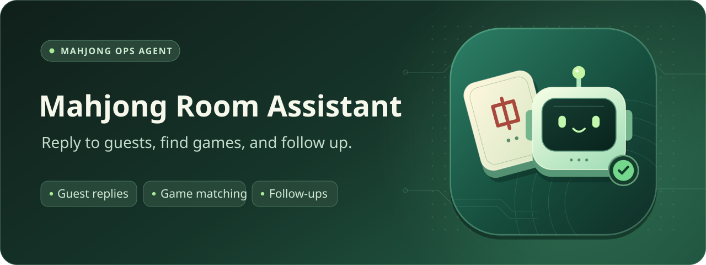
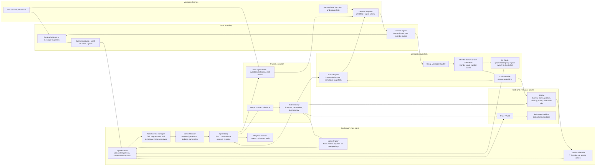

# Mahjong Ops Agent

[简体中文](README.md) · English



A goal-driven agent for mahjong halls, card and board game venues, and other local businesses that communicate directly with their customers.

The main agent plans how to help each customer find a suitable game. It checks room availability and existing games, records requests to form a game, recommends prospective players, drafts invitations, and follows up on responses. The runtime validates tool calls and enforces permissions and state transitions. It also handles persistence, content review, and auditing.

Pluggable channel adapters handle platform protocols, making it easier to add or replace channels while sharing the runtime's business logic. The web console can run on its own. WeChaty and `agent-wechat` both provide bridges for personal WeChat accounts.

> The current release is a local pilot for a single venue.

[Quick start](#quick-start) · [Message channels](#message-channels) · [Current capabilities and limits](#current-capabilities-and-limits) · [Tests and evaluation](#tests-and-evaluation)

The [product vision for personal agents that coordinate everyday activities](docs/personal_agent_product_vision.md) starts with organizing mahjong games. Over time, personal assistants and business agents could coordinate activities according to what users want and authorize.

## Why this project exists

Organizing games at a local venue relies heavily on the owner's experience. In practice, customers send incomplete, informal messages and often change their plans.

- A customer may ask “今晚 0.5 有人吗” (“Anyone playing at 0.5 tonight?”), send the shorthand “371,” or say “人齐开” (“Start once everyone is here”) in place of a form.
- Small talk and quoted replies can arrive between fragments, along with changes to the time or smoking preference and last-minute cancellations.
- Matching depends on regulars' preferred variants, stakes, smoking preferences, usual times, and relationships with other players.
- Inquiries, invitations, confirmations, and cancellations can happen concurrently. The system must count seats once and keep messages in the right conversation.
- Customer-facing replies should sound like the owner and keep the model, tools, approvals, internal notes, and other customers' private information out of the conversation.

The model interprets requests and plans actions. The backend executes them within explicit safeguards, so new business cases can be supported without a growing chain of `if-else` rules.

## Current capabilities

### Venue operations

- Recognizes requests to find or form a game, new constraints, confirmations, refusals, negotiations, cancellations, and small talk.
- Supports game variants, fixed base stakes, acceptable base-stake ranges, separate stake caps, start times, starting when everyone has arrived, session duration, smoking preferences, party composition, and requests for multiple seats.
- Checks existing games and room availability, matches customers with a game, and creates new games.
- Recommends players using customer profiles, recent invitations, invitation fatigue, and relationships.
- Drafts invitations for approval, records responses, and updates player counts and game status.
- Records a waitlist request when a suitable game is unavailable. If a match or open seat appears later, the agent can return to the original conversation to ask. The customer joins after confirming.
- Adds future bookings to the game list immediately. Proactive recruiting by direct message for a fixed-time game opens two hours before the planned start.
- Tracks start and end times, cancels expired games, releases rooms, archives failures, and retains state history.

Tools represent a fixed base stake as `stake`, an inclusive acceptable range as `stake_range={"min":1,"max":3}`, and a separate cap as `cap_score`. The backend validates numeric values and matches overlapping ranges. Game searches, forming games, waitlist entries, boards, and SQLite all preserve the range. The participants still need to confirm the exact base stake, so the system cannot pick the lower bound on their behalf. Profile text that cannot be read using the existing numeric format is flagged with `stake_preference_requires_model_interpretation` for the main model to interpret. It remains unverified as a stake match. See `tests/test_stake_ranges.py` and the dedicated range verification records below.

### Agent behavior

- In the goal-driven loop, the model chooses the tools, their order, and what to do next.
- The model interprets stake terms using the customer's full wording, units, venue conventions, history, and profile. Variant names, separators, and numeric magnitude alone are insufficient. Explicit conditions from the current exchange take priority. A range or multiple choices in a reliable profile can be used without repeatedly asking for one number.
- Multi-turn context includes recent messages, checkpoints, customer profiles and relationships, task memory, current game state, and tool results.
- Task context is isolated. A stable `conversation_id` handles channel routing, and each independent game-formation task gets a new `task_context_id`. A completed morning game stays outside a new afternoon task.
- Incomplete input is buffered briefly. After the quiet period expires, the system reevaluates the combined message fragments.
- Context management includes a token-budget check, deduplication within the current loop, projections of state needed for decisions, and summaries of long conversations.
- From the second step of a direct-message run, the model gets a progress summary of at most three lines and can report that it is stuck and ask for help early. The backend also checks for repeated observations, short cycles, and consecutive steps without progress.
- The main agent writes the final brief reply from context. Independent content review and deterministic filtering enforce factual and privacy boundaries.

### Runtime and infrastructure

- Processes messages serially within each conversation, deduplicates messages and tool calls, supports recoverable leases, and tracks conversation versions.
- Uses atomic SQLite transactions and optionally Redis for distributed coordination locks.
- Persists scheduled jobs with atomic leases, retries failures, and resumes after restart. When a job comes due, the same main agent plans the next action.
- Claims waitlist requests atomically through conditional SQLite updates, supports cross-conversation match triggers, deduplicates notifications, and checks for expired requests every 60 seconds.
- Enforces HTTP authentication, request size limits, concurrency limits, and rate limits.
- Message bridges provide channel-specific routing, gated outbound messaging, and delivery deduplication. `agent-wechat` supports durable ingress and parallel processing across conversations. Its adapter advances the event cursor after durable receipt is acknowledged.
- Records traces, context, model outputs, tool calls, state transitions, and final results end to end.
- Maintains bad cases, golden datasets, few-shot examples, and regression evaluations.

## Architecture



A single main agent owns the business objective. Input routing, summarization, copy generation, and content review are bounded, one-off model tasks with no independent business goals or state.

The main agent generates the final `reply_to_user` in the same decision call that sets the intent to inform, ask, or invite and determines the outcome. The final reply skips a separate editing call. By default, it omits previously established conditions that still hold and includes new information, actual differences, and the details needed to distinguish options. When independent review rejects a reply, it sends feedback to the same agent for revision. Any suggested edits are advisory. The optional copy-generation settings apply only to invitation or outbound drafts created by tools, with the same limits on eligible recipients and the same independent review.

If a room availability query omits both endpoints, the backend reads the current time once from a trusted source, queries the next four hours, and returns the actual interval and the source of the default. A valid explicit interval takes precedence. A single endpoint or an invalid time is rejected, and the model must avoid guessing a start such as 18:00. The default is used only to look up availability in that window. It creates no booking and establishes no availability for the rest of the day or other future times.

See [Agent Runtime architecture](docs/runtime_loop_design.md) for the implementation path. The [system and scenario guide](docs/system_explanation.html) covers 40 real business scenarios, context and memory, tools, state machines, concurrency, WeChat channels, and evaluation design.

## Main agent loop

The main loop keeps its core mechanics fixed and extends business behavior through modules at the boundaries.

```text
handle user message
  -> acquire conversation lock
  -> check message idempotency
  -> resolve current task context
  -> build context
  -> call LLM
  -> validate AgentAction contract
  -> inspect optional model self-assessment
  -> if tool calls:
       execute through ToolGateway
       append real tool results
       check progress
       continue loop
  -> else:
       generate and review customer-visible reply
       persist result
       stop
```

The design separates mechanism from policy. The main loop assembles context, calls the model, feeds tool results back, checks progress, and decides when to stop. Domain services handle business semantics, ingress routing handles channel policy, `ToolGateway` handles state changes, and the customer-visible content pipeline handles outbound safeguards. Add new business scenarios in those modules and keep scenario-specific branches out of the loop. See the [system architecture](docs/project_architecture_full.md) and [repository development rules](AGENTS.md).

On each turn, the model must return a structured `AgentAction` with the following information.

- The current objective and its status.
- A brief reason for the decision.
- Whether tool calls are needed, their arguments, and the reason for each call.
- Whether the run can stop, what work remains, and whether it depends on tool results.
- An optional progress self-assessment and whether the model confirmed a stall and is requesting early help.
- The final customer-facing reply or an explicit decision to wait for the customer or hand off to a person.

The backend rejects tool calls that violate the contract. The model can change state only through authorized tools.

### Agent run state, checkpoints, and crash recovery

Conversation summary checkpoints preserve what the model needs to remember on the next turn. `AgentRunState` records where execution should resume after an interruption. Each message that reaches the main agent gets a distinct `run_id`, and the execution snapshot is persisted in SQLite in `runtime_agent_runs`. The snapshot includes the following.

- The original input identifier, `conversation_id`, `run_version`, and trace ID.
- Whether turn preparation is complete and the next `step_index`.
- Proposed `AgentAction` values, completed tool results, results still to be fed back on the next step, and complete tool evidence.
- State transitions, usage counters for the three categories of model calls, and the state of cycle and stall detection.
- Any terminal reply already generated, run status, retry count, and lease.

Snapshots omit fully rendered prompts, model credentials, and API keys. Credential-like fields are recursively redacted before writing. The main loop checkpoints after preparation and after each complete agent step. If a node fails, the run is marked `recoverable`. The recovery worker claims it atomically with a lease, rebuilds bounded context, and resumes at `next_step_index`.

```text
Message arrives
  -> Short receipt lock: persist original input and input version idempotently
  -> Acquire the right to execute for the conversation and yield superseded turns
  -> Create the run and acquire a lease
  -> prepare turn -> checkpoint
  -> LLM / Tool step -> checkpoint
  -> ...
  -> Persist the message result
  -> Mark the run completed

Node interrupted
  -> Lease expires or run=recoverable
  -> Recovery node claims the run atomically
  -> Compare conversation_version
       New message arrived -> superseded, skip the old reply
       Version still matches -> restore budgets, progress state, and tool evidence, then resume
```

If a tool commits a side effect just before the process stops and before the checkpoint is written, recovery may propose the same tool call again. The backend derives the authoritative idempotency key from the message and normalized arguments. Tool Gateway returns the original result, preventing duplicate games or seat claims. If the final reply was persisted but channel delivery failed, recovery reuses the cached result without another model call. For direct WeChat chats, a stable send idempotency key derived from `run_id` allows bounded retries.

Automatic recovery currently covers direct-message results from the main agent and internal system tasks. The group path uses separate single-pass routing and board mechanisms. It requires a known recipient, and automatic resends of group messages after recovery remain out of scope. The defaults are shown below.

```bash
MAHJONG_AGENT_RUN_LEASE_SECONDS=120
MAHJONG_AGENT_RUN_MAX_ATTEMPTS=3
MAHJONG_AGENT_RUN_RECOVERY_POLL_SECONDS=1
MAHJONG_AGENT_RUN_RECOVERY_BATCH_LIMIT=20
```

The effective lease is at least `2 * LLM timeout + 30s`, so another worker cannot take over prematurely during a valid slow request. Targeted tests cover resuming from SQLite after a restart, recovering tool evidence, crashing after a side effect and before a checkpoint, idempotent tool replay, new messages superseding an old run, retries after channel failure, and CAS rejection of a stale worker.

Input aggregation combines message fragments. A run can also change course when the customer adds information after the objective is clear. The new raw text and input version are persisted without waiting for the long-running execution lock. The older turn yields at safe boundaries around model calls, tool calls, generation, review, and summarization. The newest turn reevaluates the objective using all input and committed facts. Already committed business actions remain recorded. In-flight network requests return normally, and the new plan continues once the current call returns to a safe boundary.

Subsequent model calls in the same run receive `previous_decision`, which contains the objective, structured assessment, plan, and reasons for revisions from the last action that passed the contract. It is labeled as a model proposal and helps preserve or correct the model's understanding. User authorization, tool execution evidence, and database facts remain authoritative. Summary reconstruction and run recovery preserve this reference. A run triggered by new input starts without the old proposal. Rejected actions and their errors remain in the trace and correction feedback, outside the accepted plan history.

`executed_requirement_contract` records the sourced parameter values from a successful game search that should carry over if the same turn creates a new game. The projection and backend consistency guard use the same reference-selection rules and protected fields. This prevents shifts in time, stakes, or smoking preference when the model reinterprets the same message while moving from searching to creating a game. The reference confers no authorization to create a game and leaves room to correct the earlier interpretation. A justified revision requires a new successful search. New runs start without the previous reference. Target table conditions, participants, and the customer's party size are kept distinct from the new game's initial player count. Arrival estimates, wait negotiations, and short-notice recruitment are outside this mechanism.

The local API and manual panel declare delivery through `claim -> dispatching -> delivered`. Older replies can be invalidated before dispatch begins. In-progress delivery and already displayed replies are preserved. Operators can keep sending messages while the manual panel is processing. Out-of-order completion cannot overwrite a newer draft or another customer's record. This delivery guarantee applies to the local API and panel. Live outbound delivery through WeChat bridges follows its own contract.

## Context and memory

The system uses two IDs with distinct lifetimes.

- `conversation_id` is the stable routing key for a WeChat contact, a group chat, or a web session. It can stay the same over time and ensures serial processing within that conversation.
- `task_context_id` identifies a bounded business task. “The 10 a.m. game” and “Let's form another game at 6 p.m.” each get their own ID.

When the current customer's game ends or is canceled and they have no other active games, their next message starts a new task. A conversation without active games also starts a new task after more than four hours of inactivity. An ongoing game preserves the task even through a long pause. Task switches have three effects.

- The old raw conversation, checkpoint, task memory, and drafts remain available for audits and replay, outside the new task's model context.
- Temporary constraints such as “I don't want to play with C this time” are archived and stop affecting game and candidate searches for the new task.
- Customer profiles and reviewed long-term relationship constraints are retained, including a regular 0.5 stake or a longstanding smoke-free preference.

The four-hour rule rotates ordinary idle tasks while preserving history and memory for future bookings. When the system creates a future game, the persisted scheduled job stores the source `task_context_id`. On wake-up, ContextBuilder first looks for that task's checkpoint. If it cannot find one, it loads raw task messages within a 4,000-token budget. An explicit quote of an older message in the same conversation uses the same restoration path. Quotes that cross between direct and group chats leave the other conversation's raw history and summaries out of context to protect access boundaries.

On each call, `AgentContextBuilder` assembles bounded context based on the current objective.

| Context | Purpose |
| --- | --- |
| Current message and input window | Preserves the original fragments for the turn, quoted messages, the quiet-period deadline, and the batch version |
| Current task window | Limits context to the start and `task_context_id` of the current game-formation task and excludes completed tasks |
| Recent conversation | Supplies short-term language context, allowing business requests and small talk to alternate |
| Conversation checkpoint | Compresses the objectives, facts, outstanding work, and open questions from long conversations |
| Explicitly restored historical task | Loads an older task's checkpoint or bounded raw history only for an in-conversation quote or trusted scheduled job |
| Customer profile and relationships | Supplies stable preferences, past tablemates, and known conflicts |
| Current task memory | Keeps constraints such as “I don't want to play with C this time” that have yet to enter the long-term profile |
| Current games and room availability | Loads only a bounded projection relevant to the conversation or customer |
| Available tools | Supplies tool schemas dynamically according to current backend permissions |
| Previous tool results | Grounds planning in actual queries and state changes |

Current task memory is isolated by the backend-bound `task_context_id`. A new objective starts without the previous objective's memory. The existing `scope` enum supplies allowed storage labels only. It establishes neither cross-task validity, automatic expiration at local midnight, nor a completed update to the long-term profile. Proposed profile updates still go through a separate review queue.

By default, a summary is triggered in either of the following cases.

- The recent conversation has reached 12 turns, at least 6 turns have passed since the last summary, and the rough estimate exceeds 3,000 tokens.
- Before a main-model call, the estimated context exceeds 85% of the per-call budget.

Summary thresholds and inputs are calculated per `task_context_id`. Normal messages use the current task resolved for the turn, and trusted scheduled events for future bookings use the source task ID stored in the job payload. SQLite retains both the latest conversation-level projection and the task-level archive. In development, only the current schema is accepted. Older databases are kept for evidence as needed, and reproducible runtime databases can be rebuilt after that evidence is saved separately. Automatic migration and backfills are outside the development workflow.

The database remains authoritative for games, seat counts, rooms, and invitations. Checkpoints help the model recover objectives and conversational facts.

Summary quality is measured by **decision consistency**. `ContextSummaryQualityEvaluator` sends the same current message to the same decision model twice. One call uses full history and the other uses only the checkpoint, compressed recent turns, and current structured state. The evaluation compares both decisions' `objective_status`, normalized tool names and arguments, and customer replies without executing the tools. Tool decisions must match exactly. Replies are compared exactly after formatting normalization by default. Live model evaluations can supply a semantic equivalence comparator.

Targeted regressions check that a summarized conversation does not repeat a failed search or lose a temporary exclusion, that invitations involving several people do not restart or get sent twice, and that later edits keep the `game_id` returned by an earlier tool call. A negative control deliberately drops a constraint and verifies that the evaluator reports the discrepancy as a failure.

```bash
PYTHONPATH=src python -m pytest -q tests/test_context_summary_quality.py
```

## Tools

| Tool | Side effects | Purpose |
| --- | --- | --- |
| `search_current_games` | No | Find current games and calculate the seating state if the customer joins |
| `check_room_availability` | No | Check room inventory for a specified time interval |
| `reserve_room` | Yes | Reserve a room for a valid game |
| `search_customers` | No | Find prospective players by profile, invitation fatigue, and relationships |
| `register_waiting_demand` | Yes | Register a bounded waitlist request when no game matches and the customer agrees to wait |
| `cancel_waiting_demand` | Yes | Close the customer's own waitlist request when they stop waiting |
| `create_game` | Yes | Create a forming game record without sending a message |
| `join_game` | Yes | Atomically add the customer to the specified game and claim a seat after explicit acceptance |
| `create_invite_drafts` | Yes | Draft invitations to prospective players for approval |
| `create_outbound_message_drafts` | Yes | Create channel-independent outbound drafts |
| `record_candidate_reply` | Yes | Record confirmations, refusals, negotiations, arrivals, and other responses |
| `update_game_requirement` | Yes | Update agreed conditions such as start time and duration for a game that is still forming |
| `update_game_status` | Yes | Progress, cancel, or archive a game according to its state machine |
| `record_user_memory` | Yes | Write task memory or a proposed long-term profile update for review |
| `update_context_checkpoint` | Yes | Update a conversation checkpoint |
| `record_badcase` | Yes | Archive a failure sample or candidate evaluation case |

For tools with side effects, the backend validates the schema, actor permissions, resource ownership, the state machine, idempotency, and concurrency versions.

### Tool dependencies and parallel execution

The main model can declare `call_id` and `depends_on` for tool calls within a step. The backend rejects duplicate IDs, unknown dependencies, and cycles, then runs the graph in dependency waves.

- The backend registers `check_room_availability`, `search_current_games`, and `search_customers` as `parallel_safe + read_only`. They can run in parallel in the same wave when there is no dependency between them.
- `create_game`, `join_game`, `record_candidate_reply`, and draft and audit writes always run serially. Tool arguments cannot bypass that rule.
- If a prerequisite fails, dependent calls do not run. A `ToolResult` returns the failure chain to the model for replanning.
- The backend restores the declaration order before feeding results to the model, regardless of completion order.
- Every call in the graph needs a unique `call_id`. An omitted or `null` `depends_on` is normalized to `[]`. Unknown dependencies, self-dependencies, and cycles are rejected.
- Older model outputs without dependency metadata keep their original serial behavior. The backend does not infer relationships between calls.

The default parallelism is `4` and can be set with `MAHJONG_AGENT_MAX_PARALLEL_READ_TOOLS`. Parallel execution most benefits tools that query external services or the network. External LLM calls still account for most end-to-end latency.

### Future bookings and scheduled recruiting

A future booking writes business state and a durable scheduled job immediately. The booking can therefore be recovered even when the original wording, such as “Ask again tomorrow,” is absent from model memory.

```text
Customer books 13:00 tomorrow
  -> Main agent searches existing games and calls create_game
  -> Game immediately appears in the list sorted by planned_start_at
  -> recruitment_status=scheduled
  -> SQLite persists an activate_game_recruitment job with due_at=11:00
  -> Job payload stores the source task_context_id
  -> Before T-2h, direct-message invitation drafts after search_customers are blocked
  -> Scheduler claims the job atomically
  -> Internal game_recruitment_window_opened event goes back to the main agent
  -> Main agent checks current game state, profiles, and candidates, and plans search and invitations
```

Job IDs and idempotency keys are derived deterministically from `game_id + recruitment_opens_at`. Claiming uses SQLite `BEGIN IMMEDIATE`, so only one process sharing the database can acquire the lease. If that process fails, the job can be claimed again after the lease expires. Failed jobs retry according to configuration. When a game fills, is canceled, or ends, the corresponding job is canceled or completed. The internal wake-up creates a complete trace and restores summary data or raw messages from the source task. The internal summary stays out of customer messages.

Persisted jobs survive process restarts. An on-time wake-up requires the service to be running and the Mac to be awake at the scheduled time. When the service returns, the scheduler immediately claims overdue unfinished jobs. A multi-machine production deployment needs an always-on service or external scheduling infrastructure for availability.

The defaults are shown below.

```bash
MAHJONG_SCHEDULED_TASK_POLL_SECONDS=1
MAHJONG_SCHEDULED_TASK_BATCH_LIMIT=50
MAHJONG_SCHEDULED_TASK_MAX_ATTEMPTS=3
MAHJONG_SCHEDULED_TASK_RETRY_SECONDS=60
MAHJONG_SCHEDULED_TASK_LEASE_SECONDS=180
```

The web console sorts the current game list by time and separates today's games from tomorrow's. Games whose recruitment window is still closed show when recruiting is scheduled to start and remain visible in group game lists and existing-game searches.

### Waitlist requests and match triggers

When a customer has found no suitable game, the main agent calls `register_waiting_demand` only if the customer explicitly agrees to keep waiting. The waitlist entry records the destination conversation, customer identity, stakes, smoking preference, time preferences, relationship constraints, and expiration. The entry only records the waitlist request. A real game and the customer's explicit confirmation are required before the customer can join.

```text
A finds no existing game and agrees to wait
  -> register_waiting_demand
  -> SQLite waiting_demands(status=active)

B creates a game, or a player leaves a game
  -> ToolGateway after_tool_execute hook
  -> MatchTrigger checks stakes, smoking preference, time, and relationship constraints
  -> Conditional UPDATE claims the waitlist request atomically
  -> OutboundDispatcher builds a redacted SystemTriggerMessage
  -> Acquire A's conversation lock and re-enter the same AgentLoop
  -> Draft a notification asking "There's a game ... would you like to play?"

A explicitly replies "I'll play"
  -> Normal handle_user_message
  -> join_game validates capacity and identity and joins the game atomically
```

A match event includes only public game information such as stakes, smoking preference, time, current seat count, and open seats. Other participants' identities stay private. The notification idempotency key is derived from `demand_id + game_id`. If two nodes see the same request, a conditional update under SQLite `BEGIN IMMEDIATE` allows only one to claim it. If dispatch fails, the claim for that request is released so it can be retried. The durable scheduler scans for expired requests every 60 seconds and idempotently schedules the next scan when each job completes.

### Alternate game plans and shared participants

The same customer can hold a provisional seat in several games still forming at overlapping times. This represents availability for multiple options. A commitment is recorded when a game is filled. The system uses `Game.status + GameParticipant.status` to distinguish the two states.

- An active participant in a `forming/inviting` game holds a provisional seat and can appear in any number of candidate plans.
- An active participant in a `ready` game has committed. A customer can belong to only one confirmed game for an overlapping time window.

When a candidate game fills its last seat, `join_game` or the compatible `record_candidate_reply` operation performs three changes in a single write transaction. It moves the winning game to `ready`, changes the shared customer's status to `superseded` in other overlapping games, and recalculates their open seats and invalidates the corresponding open invitations. SQLite uses `BEGIN IMMEDIATE` to serialize competition across games. Even when multiple nodes confirm the last seats concurrently, only one conflicting game wins. The same customer can participate in separate games whose times do not overlap.

Candidate search keeps customers eligible while they have provisional seats. It ranks customers holding multiple provisional seats lower and excludes customers already committed to an overlapping `ready` game.

When filling a temporary vacancy, the system can release seats the booking contact reserved for companions while preserving the original `game_id` and room reservation. Once companions respond independently, they manage their own seats. Pass `alternative_to_game_id` to `create_game` to record related options at different times for the same organizer and conversation. The system rejects ordinary duplicate requests and requests that overlap a confirmed game. When one option fills, the same transaction releases shared participants from the conflicting options.

A separate field contract governs updates to game requirements. The backend calculates the seat count and end time. Persistent jobs coordinate game board updates, which require content review and channel authorization before publication. Records and drafts reflect business state. The channel reports the actual send result.

## Quick start

After cloning the repository, use [one-command startup](#one-command-startup-for-wechat-and-the-main-agent) to start WeChat, the main agent, and the adapter together. The sections below also cover manual configuration and running the main agent on its own.

### 1. System requirements

> **A MacBook running macOS is recommended.** Windows support and hands-on testing are still pending. Runtime behavior and compatibility on Windows have yet to be confirmed.

- Python 3.11+
- DeepSeek or another OpenAI-compatible model API
- Node.js 20+ for the `agent-wechat` adapter. Frontend regression tests also require Node.js, and the WeChaty bridge requires pnpm.
- Redis is optional for single-machine deployments.

### 2. Install

```bash
git clone git@github.com:Schatt3n/mahjong-ops-agent.git
cd mahjong-ops-agent
python -m pip install -e ".[dev]"
```

To use Redis for coordination locks, install the distributed extra.

```bash
python -m pip install -e ".[dev,distributed]"
```

### 3. Configure the model

At startup, the project loads `.env` from the repository root. Existing environment variables take precedence. Save the settings below to `.env` and enter your own model API key.

```dotenv
MAHJONG_LLM_PROVIDER=deepseek
MAHJONG_LLM_MODEL=deepseek-flash
MAHJONG_LLM_API_KEY=<your-api-key>
MAHJONG_LLM_BASE_URL=https://api.deepseek.com

# Apply backpressure to provider requests. Conversations can run in parallel,
# with at most three model HTTP requests in flight at once.
MAHJONG_LLM_MAX_CONCURRENCY=3

# Optional DeepSeek thinking mode for the main model. The default is off.
# Enabling it affects planning and draft generation when they share this client.
# The complex semantic evaluation judge uses its own fixed enabled/low/16384 settings.
# Evaluation-only blind state and amount-scope classifiers keep thinking off.
# These classifiers do not participate in customer replies.
MAHJONG_LLM_THINKING_MODE=enabled
MAHJONG_LLM_REASONING_EFFORT=high
MAHJONG_LLM_MAX_COMPLETION_TOKENS=16384
# Model-call timeout for local replay with high reasoning effort.
# Keep timeout evidence and count timeouts as failures.
MAHJONG_AGENT_LLM_TIMEOUT_SECONDS=90
# Optional cap of 60 seconds per HTTP attempt, leaving time to retry within the total budget.
MAHJONG_LLM_ATTEMPT_TIMEOUT_SECONDS=60
# Total call budget and per-attempt HTTP cap for the independent complex semantic judge.
# The default is 180 seconds. The main agent and blind classifiers keep their own budgets.
MAHJONG_SEMANTIC_JUDGE_TIMEOUT_SECONDS=180

# Defaults for independent customer-visible reply review in production,
# simulations with live models, and evaluation gates.
# Reuse the main model's connection by default. Reasoning, output, and time budgets
# are separate, including the per-attempt timeout.
MAHJONG_REPLY_REVIEW_LLM_THINKING_MODE=enabled
MAHJONG_REPLY_REVIEW_LLM_REASONING_EFFORT=low
MAHJONG_REPLY_REVIEW_LLM_MAX_COMPLETION_TOKENS=16384
MAHJONG_REPLY_REVIEW_LLM_TIMEOUT_SECONDS=180
MAHJONG_REPLY_REVIEW_LLM_TEMPERATURE=0

# Per-call input budget for the main agent, with room for multi-step planning
# after tool results arrive. Summarization thresholds, per-step call limits,
# and the total budget independently cap usage.
MAHJONG_AGENT_MAX_TOKENS_PER_CALL=64000

# Maximum number of backend-authorized read-only tools to run in parallel per agent step.
MAHJONG_AGENT_MAX_PARALLEL_READ_TOOLS=4

# Optional. Leave blank to load or generate a local token in data/runtime_api_token.
MAHJONG_AGENT_API_TOKEN=

# Optional room and Redis settings.
MAHJONG_ROOM_IDS=room_1,room_2,room_3
MAHJONG_REDIS_URL=redis://127.0.0.1:6379/0
```

As of October 30, 2026, the `deepseek-flash` alias referred to DeepSeek-V4.1-Flash-1017. The example uses `high` reasoning effort. Restart the service to apply local configuration changes. [DeepSeek model documentation](https://api-docs.deepseek.com/quick_start/pricing)

The project maps DeepSeek's `thinking` and `reasoning_effort` settings according to the provider's API contract. It explicitly supports `low`, `high`, and `max` and omits the temperature parameter when thinking is enabled. Reasoning consumes output tokens and affects latency. The current daily limits are conservative estimates separate from provider billing. Production, simulations with live models, and evaluations share a configuration factory for independent reply review. By default, review uses the same model with low reasoning effort and a 180-second budget. Main planning and draft generation follow their own settings. Record reasoning mode and budget with each evaluation and report pass rates by configuration. [DeepSeek thinking mode documentation](https://api-docs.deepseek.com/guides/thinking_mode)

The high-effort example caps reasoning and final text at 16,384 tokens combined. Actual usage may be lower. Keep historical replays with a 6,400-token budget separate from results under the new limit. Raising the token limit leaves request deadlines as configured. Restart running services to load the updated settings.

Complex semantic evaluation uses fixed `enabled/low/16384` settings and the `responsibility_scope_v8_20261105` contract. Its transport budget comes from an explicit `judge_timeout_seconds` first and `MAHJONG_SEMANTIC_JUDGE_TIMEOUT_SECONDS` second, with a 180-second default. The independent judge configures the same value for the per-attempt HTTP cap and total call budget. Individual attempts still reserve retry time as described below. The main agent and the blind state and amount classifiers keep their own budgets. A 180-second probe with the original input finished in 70,970.808 ms. The provider reported 11,634 completion tokens, including 11,176 reasoning tokens, and the judge correctly rejected the negative case. The original 60-second attempt did not produce a complete judgment. Calibration, full-gate results, the provider's internal root cause, and a reliable success rate remain unestablished by this probe. [Evaluation budgets and calibration](eval/README.md)

Queueing, retry backoff, and fallback share one total budget. When retries are allowed, the effective HTTP limit per attempt is the smaller of the explicit `attempt_timeout_seconds` cap and half the total budget remaining at the start of the retry loop. Later attempts can only reduce this limit. The explicit cap cannot override the retry reserve. With 45 seconds total and a 60-second explicit cap, the first attempt gets at most 22.5 seconds. An explicit cap of 10 seconds reduces that to 10 seconds. Single-attempt calls need no retry reserve and remain subject to both the explicit cap and the remaining budget. The client checks the remaining time while reading successful and error response bodies and across chunk boundaries. Continued whitespace never resets the budget. DNS, connection setup, and response headers use `urllib` timeouts, which may leave some lower-level blocking operations outside the client's direct control. Client metrics track `http_attempts`, `http_retries`, `http_timeouts`, and `http_recoveries` separately from safe recovery after a model action contract error.

Model results carry per-call safety diagnostics in traces for planning, generation, review, and summarization. The traces retain request settings, HTTP attempts and routes, finish reasons, provider usage, and the lengths of response and reasoning fields. Authentication values and raw reasoning text are excluded. The existing contract rejects empty response text and retains the evidence, without automatic retries for that condition. A rejected main model response also carries a minimal `response_source` that ties the response, rejection feedback, and next actual model input to the same call. An empty response qualifies as safe recovery only when the evidence establishes the source, feedback, absence of side effects, subsequent valid execution, business outcome, and independent semantic assessment. Error counts are still reported separately. [Evaluation documentation and reproduction limits](eval/README.md)

### 4. Start the service

#### Run the main agent on its own

```bash
python scripts/run_agent_app.py
```

- [Web console](http://127.0.0.1:8790/)
- [Health check](http://127.0.0.1:8790/api/health)
- [Runtime information](http://127.0.0.1:8790/api/runtime) requires authentication.

#### One-command startup for WeChat and the main agent

This launcher uses `agent-wechat`. In Codex, select **启动棋牌室运营** from the Run menu. On macOS, you can double-click [`启动棋牌室运营.command`](启动棋牌室运营.command) in the repository root in Finder, or run `bash ./启动棋牌室运营.command` from a terminal.

The launcher checks that agent-wechat, the Python main agent, and the Node.js adapter are ready, then prints the console URL. WeChat reuses locally saved sessions. If you need to sign in again, macOS opens the QR code generated by the upstream service. Scan it or confirm the login in WeChat on your phone, and the adapter connects automatically. Stopping the launch task or pressing `Ctrl-C` shuts down the services started by that invocation. Already-running services can be reused if their configuration passes validation.

**Keep the agent running with the Mac display off**

With the display off or the screen locked, the agent can still receive WeChat messages, process replies, and run scheduled tasks as long as the Mac stays awake, the network remains available, and the WeChat session stays online. The macOS idle sleep setting still applies. System sleep pauses live message processing and scheduled jobs. After the Mac wakes and the service resumes, it processes persisted jobs that are due. Recovery of all WeChat messages received during sleep still needs verification.

To keep the agent running when the display turns off, connect the MacBook to power and leave the lid open. In **System Settings → Battery → Options**, turn on **Prevent automatic sleeping on power adapter when the display is off**. [Apple sleep and wake settings](https://support.apple.com/en-gb/guide/mac-help/mchle41a6ccd/mac)

Use the same launcher after a fresh clone. The first online run reuses any existing Python 3.11+, Node.js 20+, and `wx` installations. It downloads missing tools at versions pinned by the repository, verifies their SHA-256 checksums, and caches them in `runtime_data/wechat-stack-tools/`. The main agent and adapter run directly from the checkout.

Automatic `wx` installation supports Apple Silicon macOS and x86-64 or ARM64 Linux with glibc 2.36 or newer. On Linux, use `bash`, `curl`, and `tar`. Run `bash ./启动棋牌室运营.command`. The QR code opens automatically when a desktop session and `xdg-open` are available. If you install `wx` yourself on macOS or Linux, set `MAHJONG_WECHAT_WX_BIN` to its path.

WeChat uses the `wx` daemon and opens the QR code when a scan is needed. The launcher checks for the latest stable agent-wechat release and reports available updates in the terminal. The repository pins the downloaded version. Check compatibility with the adapter before upgrading.

If no model is configured, run the launcher from a terminal and enter a DeepSeek API key when prompted. The launcher hides the key while you type and saves it in the private, Git-ignored `.env.wechat-model.local` file. You can also configure a supported model in advance in `.env`. WeChat sessions, the business database, and credentials stay on the local machine.

Use the Git-ignored `.env.wechat-stack.local` file for local deployment settings. The launcher reads the process environment first, then this file, then `.env`. Saved DeepSeek settings fill in missing local model configuration.

| Local setting | Default and purpose |
| --- | --- |
| `MAHJONG_WECHAT_DATA_DIR` | `~/.local/share/agent-wechat`, the upstream login state directory. When `XDG_DATA_HOME` is set, the default is its `agent-wechat` subdirectory. |
| `MAHJONG_WECHAT_SERVER_CONFIG` | Existing agent-wechat server configuration. Set this if your desktop Hub uses a separate configuration file. |
| `MAHJONG_AGENT_WECHAT_TOKEN_FILE` | `api-token` in the upstream data directory. Override this if you already use a separate token file. |
| `MAHJONG_AGENT_WECHAT_ACCOUNT` | Optional for a single account. For multiple accounts, specify an ID or alias. |
| `MAHJONG_AGENT_WECHAT_BASE_URL` | `http://127.0.0.1:6174`, the upstream service URL. |
| `MAHJONG_AGENT_PORT` | `8790`, the main agent port. |
| `MAHJONG_AGENT_WECHAT_CONTROL_PORT` | `8792`, the WeChat adapter control port. |

Existing deployments can keep their state directories, ports, and credential paths. The adapter controls outbound messaging, which is off by default. [Adapter configuration](integrations/agent-wechat-adapter/README.md)

### 5. Send a test message

Open the web console first so the runtime can initialize its local token. The example reads the default token file. If you set `MAHJONG_AGENT_API_TOKEN`, use that value instead. If you set `MAHJONG_AGENT_API_TOKEN_PATH`, read the token from that file.

```bash
MAHJONG_LOCAL_API_TOKEN="$(cat data/runtime_api_token)"
curl -X POST http://127.0.0.1:8790/api/message \
  -H 'Content-Type: application/json' \
  -H "Authorization: Bearer $MAHJONG_LOCAL_API_TOKEN" \
  -d '{
    "conversation_id": "trial_001",
    "sender_id": "customer_001",
    "sender_name": "",
    "message_id": "message_001",
    "text": "今晚七点0.5无烟，帮我组一个"
  }'
```

The sample asks the venue to put together a nonsmoking game at 7 p.m. tonight with a stake of 0.5.

## Message channels

The web console uses the business HTTP API. Bridge adapters convert platform events into a common message format and send them to `POST /api/channels/{channel}/raw`, preserving message, conversation, and sender IDs. The runtime handles identity mapping, routing, reply review, and outbound authorization per channel. Adapters that support sending accept requests through control endpoints such as `/send`.

To add a bridge, implement protocol conversion, register the channel with the runtime, and wire up routing and identity mapping. The bridge can then reuse game coordination, context, and memory logic. Both WeChat adapters use the same conversation IDs when connected to the same WeChat account to preserve history. Channel logs and outbound records identify the actual bridge. [Channel definitions](scripts/agent_runtime_app.py) · [Adapter control endpoints](integrations/agent-wechat-adapter/README.md#控制面)

### agent-wechat channel

Install and upgrade `agent-wechat` independently using tagged releases. This repository's Node.js adapter receives events over the upstream HTTP/SSE API and submits them to the runtime's raw message endpoint. Once SQLite has stored the message, the endpoint returns HTTP `202` and the adapter advances its cursor. The background worker processes messages in order within each conversation and can handle different conversations concurrently.

The agent can use recent owner replies from the same direct chat in later turns. Before sending an automatic reply, the adapter checks for a corresponding owner reply and suppresses the pending reply when it finds one.

The routing defaults are independent. `MAHJONG_AGENT_WECHAT_ROUTE_SCOPE` defaults to `incoming_only`, and `MAHJONG_WECHATY_ROUTE_SCOPE` defaults to `self_only`. Outbound messaging is off by default. When launching components separately, set `MAHJONG_WECHATY_OUTBOUND_BASE_URL` to the control URL of the adapter you are using. [Adapter deployment and permissions](integrations/agent-wechat-adapter/README.md) · [Channel architecture and contract checks](docs/agent-wechat-adapter.md)

### WeChaty pilot channel

Start the runtime and open the web console, then run these commands from the repository root. If you configured `MAHJONG_AGENT_API_TOKEN` or `MAHJONG_AGENT_API_TOKEN_PATH` in `.env`, set the same variable in your current shell first.

```bash
export MAHJONG_AGENT_API_TOKEN="${MAHJONG_AGENT_API_TOKEN:-$(cat "${MAHJONG_AGENT_API_TOKEN_PATH:-data/runtime_api_token}")}"
cd integrations/wechaty/mahjong-wechaty-bridge
pnpm install

export MAHJONG_WECHATY_SEND_ENABLED=false
export MAHJONG_WECHATY_AUTO_SEND_REPLY=false
pnpm start
```

The bridge and runtime handle incoming messages as follows.

- Forward raw WeChat messages to `/api/channels/wechaty/raw`.
- Aggregate message fragments by `conversation_id + sender_id`.
- Use a nominal 30-second quiet period and an additional 5-second grace period by default. The grace period prevents the scheduler from racing the next message when someone sends fragments exactly 30 seconds apart. The model still sees the nominal quiet period.
- When the input model identifies a clear operational request in an allowlisted direct chat, return a short configurable acknowledgment before the persisted batch reaches the main agent asynchronously. The default, “好的，我看看” (“Okay, I'll take a look”), confirms receipt only. Looking up games, creating one, and contacting candidates each require separate execution evidence.
- Reuse the same batch version and input classification for background processing, avoiding a second model call for classification. A new fragment advances the batch version. Conversation version checks prevent stale runs from writing through tools or releasing customer-visible output.
- Store immediate acknowledgment jobs in SQLite's `pending_input_batches` so the scheduler can resume them after restart. Suppress a later reply if it exactly matches the acknowledgment.
- `MAHJONG_WECHATY_IMMEDIATE_ACK_ENABLED` enables immediate acknowledgments for WeChat by default. `MAHJONG_API_IMMEDIATE_ACK_ENABLED` controls the HTTP console and is off by default. Set the acknowledgment text and the delay before the background worker claims the batch with `MAHJONG_IMMEDIATE_ACK_TEXT` and `MAHJONG_IMMEDIATE_ACK_BACKGROUND_DELAY_SECONDS`.
- `MAHJONG_INPUT_QUIET_BOUNDARY_GRACE_SECONDS` sets the grace period and defaults to `5`. `MAHJONG_API_BACKGROUND_PROCESSING_ENABLED` controls background execution in the HTTP console and is on by default.
- By default, only allowlisted or test-scope messages reach the main agent.
- Designated groups can run in observation-only mode. An input model classifies messages as operational, casual, or uncertain. Observation ends before the tool loop, business-state changes, and outbound reply generation.
- Observation-only messages are written idempotently to `runtime_channel_observations` by `channel + source_message_id`. The raw JSONL log preserves the original evidence, and SQLite stores the group, sender, text, semantic classification, and routing outcome. The raw message remains available if the model fails.
- Explicitly authorized groups can use managed boards. L1 filters the bridge's own echoes and recognizes claims by board number. L2 decides whether a message needs the venue's attention. When members recruit on their own and the game variant and party size are clear, the runtime records the game silently and includes it in the next board update. The organizer confirms seats. The venue stays out of casual discussions about game variants. Explicit requests to look up a game, add it to the board, coordinate it, or continue the sender's existing request follow the appropriate business workflow.
- Each person in a managed group gets a separate conversation, `group:<room_id>:customer:<customer_id>`. The model receives the minimum isolated context for that person.
- An explicit request to fill seats in a recorded group game can continue in the original group context. Other complex requests can use the sender's private chat context when their WeChat friendship allows it. Outbound permission is checked independently. For a new request, the venue messages the requester privately only after finding specific options that are still available. Using private context does not require acknowledging the request in the group first.
- The board is generated from authoritative `Game` state. Routine changes are merged within a 30-second window. Significant changes such as claiming or releasing seats queue an immediate refresh. Each publication saves an immutable snapshot mapping board numbers to `game_id` values.
- Games created in a regular direct chat are associated with the venue's configured managed board groups and receive a persistent refresh task in the same atomic store operation. This association requires neither a WeChat friendship nor a record of switching from group to private chat. Games created in a group retain their originating scope. Direct invitations are optional. A turn with no candidates may finish synchronously once a board refresh is already scheduled. A refresh task records pending publication, and private notification depends on later conditions.
- On startup, the app registers exact configured group IDs so even the first direct chat can schedule a board update. Configuration by group-name keyword still needs a group message envelope to confirm the actual group identity. Group outbound authorization is separate. Pausing it keeps queued refresh tasks without granting any permissions. Updates that arrive during processing for the same group are merged into a single follow-up task. Publication is serialized per group by a lease and retried after send failures. A stale worker cannot send an outdated board or complete a newer task.
- Before sending a board, the runtime selects public fields, runs production content review, and applies a final deterministic filter. Retries with the same task, number mapping, and content use a stable publication anchor, so an already-saved successful snapshot is sent once. The task lease defaults to 180 seconds and is configurable with `MAHJONG_SCHEDULED_TASK_LEASE_SECONDS`. Pausing authorization does not use up failure retries.
- A quoted board resolves its number against that exact version. Without a quote, only the latest board number is accepted, preventing a stale number from assigning someone to the wrong game.
- Sending and automatic replies are off by default and each requires explicit activation.
- Failed inbound messages go into a local spool. Successful sends enter a delivery ledger for deduplication.

Observation-only groups are read from `data/wechaty_observe_only_rooms.local.json` by default. `room_ids` uses exact matches, and `topic_keywords` uses substring matching so a venue name or bulletin appended to a group name does not break matching. Query structured observations through `GET /api/channels/wechaty/observations` with optional `room_id`, `room_topic`, `semantic_action`, and `limit` parameters. The `wechaty_observe_only_message_analyzed` trace event includes `state_mutation_allowed=false` and `outbound_allowed=false`. [Example observation-only group configuration](integrations/wechaty/observe_only_rooms.example.json)

Enable managed groups explicitly through environment variables or a local configuration file.

```bash
export MAHJONG_WECHATY_MANAGED_ROOM_IDS='@room-id-1'
export MAHJONG_WECHATY_MANAGED_ROOM_TOPICS='测试麻将群'
export MAHJONG_WECHATY_MANAGED_ROOM_BOARD_ENABLED=true
# Leave outbound messaging off by default. Enable it separately after an allowlisted pilot.
export MAHJONG_WECHATY_MANAGED_ROOM_OUTBOUND_ENABLED=false
export MAHJONG_WECHATY_BOARD_MERGE_WINDOW_SECONDS=30
```

The default local file is `data/wechaty_managed_rooms.local.json`. For a group with a known default mahjong variant, set `"self_recruitment_default_game_types": {"@room-id-1": "hangzhou_mahjong"}` by room ID. This only fills in the general mahjong variant when the member's opening post omits it. An explicitly stated variant takes precedence. Recording a member's game requires their party size and an identifiable mahjong variant. Start time, stakes, and smoking preference can be left blank if unmentioned. An explicit “人齐开” (“start once everyone is here”) is saved as the start condition. [Example managed group configuration](integrations/wechaty/managed_rooms.example.json)

Observation-only mode and managed boards are independent. Only groups explicitly configured as managed can change game state. Managed configuration takes precedence when a group matches both. Game-to-group associations include `room_id`, so one request from a direct chat can be added to multiple authorized groups.

#### Experimental group session pipeline

A single group can have several simultaneous seat claims, inquiries, and discussions about forming games. The separate `GroupSessionPipeline` reproduces these conditions in simulation.

```text
Group message
  -> OwnerMessageParser (deterministic parsing of the owner's board)
  -> QuickFilter (drops noise)
  -> MessageAccumulator (groups messages from one sender with a 5-second quiet period)
  -> SessionRouter (assigns messages using quotes, sender, timing, and structured features)
  -> GroupSessionClassifier (uses BoardState and the current session)
  -> SessionMerger / SessionCrystallizer
  -> private_switch / group_reply / ignore / board_update
```

- A `ChatSession` represents one seat claim, inquiry, or discussion about forming a game. A WeChat group or a customer's ongoing conversation can contain several sessions. Raw messages from separate topics stay out of each other's model context.
- A session can have multiple participants. Quotes take precedence, followed by sender time windows and structured features. Two conflicting precise facts prevent a merge. Turning a range such as “tonight” into a specific time such as “7 p.m.” is valid refinement.
- A multi-line board posted by the owner replaces `BoardState`. A single complete game description updates or adds that entry while leaving other games in place. `BoardState` is persisted in SQLite in `runtime_group_board_states`. Sessions currently live in memory.
- If the model marks a claim as unique and the extracted conditions match multiple board entries, contract validation marks it as ambiguous and switches to a direct chat for confirmation.
- Group classification outputs undergo strict contract validation. Invalid output gets one attempt at repair with the original validation feedback. If repair fails, the runtime records `classification_failed` and retains the raw message. It leaves unknown fields unresolved and takes no business action.
- This pipeline runs in deterministic tests and simulations with live DeepSeek calls. The existing WeChaty group handler continues to handle live traffic, and observation-only groups leave business state and outbound messaging untouched. Group-by-group rollout of the experimental pipeline requires trace integration, an action router, and rollout switches.

Run the simulation with a live model using the following command.

```bash
PYTHONPATH=src python scripts/run_group_session_live_simulation.py \
  --env-file ~/.local/share/mahjong-ops-agent/.env
```

The simulation writes full classifications, merged sessions, and session crystallization flags to `runtime_data/group_session_live_simulation_report.json` for review outside the console.

Use a test account, a small allowlist, and human approval. Personal WeChat bots are subject to account restrictions, and the unofficial integration has no guaranteed SLA.

## API

| Method | Path | Purpose |
| --- | --- | --- |
| `GET` | `/api/health` | Check service health |
| `GET` | `/api/runtime` | View runtime configuration and component status |
| `POST` | `/api/message` | Submit web or API messages |
| `POST` | `/api/input-batches/result` | Read the result of an asynchronous batch by `batch_id` |
| `GET` | `/api/state` | View games, drafts, profiles, and memory |
| `GET` | `/api/traces?trace_id=...` | Look up a trace |
| `GET` | `/api/logs?limit=...` | Read the end of the log |
| `POST` | `/api/invite-drafts/action` | Approve, reject, or send an invitation draft |
| `POST` | `/api/badcases` | Flag a failure case manually |
| `POST` | `/api/reset-state` | Clear local test state and memory |
| `POST` | `/api/channels/wechaty/raw` | Submit raw WeChaty messages |
| `POST` | `/api/channels/{channel}/raw` | Submit raw bridge messages for `wechaty` or `agent-wechat` |
| `GET` | `/api/channels/{channel}/raw` | Read the most recent raw messages from a channel |
| `GET` | `/api/channels/{channel}/observations` | View channel observations and routing outcomes |

Protected endpoints always require authentication. CLI clients and adapters can send a bearer token or `X-Mahjong-Agent-Token`. The browser console uses a local cookie. The token comes from `MAHJONG_AGENT_API_TOKEN` or the local token file.

When the console uses fragment aggregation, the message endpoint may first return a `poll_batch_id`. The console automatically submits it as `batch_id` to `/api/input-batches/result` to retrieve the status and final reply.

## Data and observability

The default local paths are shown below.

```text
data/agent_runtime.sqlite3        # Primary state database
logs/agent_runtime_trace.log      # End-to-end agent trace
logs/wechaty_weixin_raw.jsonl      # Raw WeChaty message log
logs/agent_wechat_weixin_raw.jsonl # Raw agent-wechat channel message log
runtime_data/                     # Local evaluation reports and temporary databases
```

SQLite stores customer profiles and relationships, games, game participants, rooms, invitation drafts, state transitions, conversations, checkpoints, task memory, message results, the idempotency ledger, pending input batches, and persistent scheduled tasks. `runtime_game_participants` uses a composite primary key of `(game_id, customer_id)` and separately records participation status and `joined_at`. Participant records are stored outside `runtime_games.payload`. Redis, when configured, coordinates processes. SQLite remains authoritative for business state.

### Development schema policy

The current SQLite schema version is `4`. The runtime validates it strictly at startup. During development the project maintains only the current schema and rejects a database with a version mismatch. Before recreating a rebuildable runtime database, preserve tests, failure cases, golden and adversarial datasets, and original channel observations separately. If a production release later has state that cannot be rebuilt, prepare a release-specific offline migration, backup, validation, and rollback procedure. [Schema version in code](src/mahjong_agent_runtime/stores/sqlite/schema.py)

Use `trace_id` to follow a request end to end.

```text
User input -> Context assembly -> Model request/response -> Tool calls/results
           -> State transitions -> Main agent reply -> Independent content review -> Final reply
```

The log uses this format.

```text
traceId-yyyy-mm-dd hh:mm:ss-loglevel: content
```

## Tests and evaluation

For everyday development and ordinary commits, run the unified offline checks. They run the full pytest suite once and check runtime boundaries, evaluation assets, and deterministic regressions. For changes that affect model behavior, also replay the affected scenarios and closely related negative cases with the target model.

During solo development, work and sync on `main`. Run the full checks when the repository maintainer explicitly requests them. Once other developers are actively contributing, the final candidate must pass the full checks before merging into `main`, pushing to `main`, or releasing. The full checks also cover real shop-owner conversations with independent semantic review, group chats, game inquiries, privacy, and concurrency. Record any coverage you could not verify because API keys were unavailable.

```bash
# Routine offline evaluation
PYTHONPATH=src python scripts/run_evals.py

# Full checks, stopping after the first failing group of checks by default
PYTHONPATH=src python scripts/run_evals.py --full
```

See [Running evaluations](eval/README.md#运行评估) for targeted replay commands, how to rerun failures, and how to interpret reports. To exercise discussions among multiple group members, chains of quoted messages, and games arranged for the next day, run the [anonymized group-chat timeline replay](eval/README.md#脱敏群聊时间线回放) separately.

Complex semantic judgments use a fixed reasoning configuration and are evaluated separately from blind state and monetary checks. The 2026-10-31 development checkpoint recorded 33/34 shop-owner conversations, 68/68 concurrency cases, 6/6 game inquiries, and 10/10 privacy cases. The single empty-response case subsequently passed 1/1 on rerun with the same code. See the [original development handoff](docs/development_handoff_20261030.md) for historical scores and failures.

The golden datasets store inputs, context, reference replies, and expected meanings. An independent evaluator checks each expected meaning, and the actual tool calls and persisted state also count toward acceptance. The live replays include the existing shop-owner JSONL expectations and the added multi-turn case in which the agent offers to ask around after the customer says any time works. Dedicated pytest tests still cover two historical timelines. Reports list any portions outside the live replay separately from the live semantic pass rate. See [Evaluation assets](eval/README.md).

Under the acceptance criteria confirmed by the user, a backend rejection can count as a safe recovery if the original trace proves the erroneous step never executed or sent a message, the agent received the rejection feedback and later completed the task through a valid action, and both the business state and independent semantic checks passed. The report stores `recovery_metrics` per case and aggregates them in `recovery_summary`. It preserves the original errors and counts them separately. Missing evidence, unrecovered errors, and failures involving meaning, permissions, or data still block acceptance. The action contract stays strict. See [Recovery criteria and evidence](eval/README.md).

### 100-user agent load simulator

To supply your own customers and exact group-chat messages, open `/simulation` and select **导入 JSON 场景** (Import JSON scenario). Load character profiles, friend relationships, and queues for group and private messages in one step. Then choose **执行下一条** (Run next message) or run the queue continuously. Importing only loads the scenario. See [Manual scenarios](docs/manual_scenarios.md) for the format and examples. Simulated group messages use the production group entry point. The observability page uses the actual result to distinguish group replies, private replies, and silence. It retains and labels earlier runs that called the runtime directly.

The environment in `tests/simulation/` is isolated from the development database and has four main layers plus a short-term state backend.

| Layer | File | Responsibility |
| --- | --- | --- |
| User factory | `sim_factory.py` | Uses Faker to generate 100 Chinese-speaking users, balances, and preferences for Sichuan or Chinese Official Mahjong, writes them to a dedicated `test_sim.db`, and creates one group chat for all users |
| Behavior policy | `behavior_policy.py` | Assigns 80 lurkers, 15 active users, and 5 outlier users. Five users who send messages consistently interleave small talk with business discussion. Based on `DialogState`, they can continue the business discussion, insert small talk, return to the original task, start a new topic, or stay silent |
| Scheduler | `sim_orchestrator.py` | Uses a `PriorityQueue`, up to 10 sender threads, and a global sliding-window rate limit. Tracks each user’s business topic, conversation phase, turn count, and wait state. Processes each `conversation_id + thread_id` in order while other topics in the same group can continue. Stops on message or time budgets, lack of progress, safety limits, or repeated SQLite lock errors |
| Bidirectional adapter | `sim_adapter.py` | Sends WeChaty-shaped HTTP payloads through the production group entry point for group messages. Delivers the sandbox’s actual output to group or private inboxes and records the routes, recipients, and topic-level reply gates |
| Short-term state | `sim_state.py` | Provides one contract for the in-memory and Redis backends. Stores simulated inboxes, topic-level reply gates, and input and output event streams. SQLite owns business facts such as customers, games, and invitations |

Select the mock model explicitly for an offline load test. This mode runs without API keys or a live model client.

```bash
python -m pip install -e ".[simulation]"
SIM_LLM_MODE=mock PYTHONPATH=src \
  python tests/simulation/hundred_user_simulator.py --speed=10x
```

In a multi-turn conversation, the simulator waits for the agent’s reply before generating the user’s next turn. The `conversation_id` identifies a private chat or group room, and each distinct simulated topic has a hidden `thread_id`. The simulator tracks each user’s business topic, latest agent reply, whether they intend to return from small talk, and the associated thread. Selected users can discuss a game, switch to small talk, and return to the same business thread with “对了，刚才那个局……” (“By the way, about that game…”). When a group reply contains an `@nickname` mention, only that user can reply in the current `thread_id`. Other threads in the same group can continue. Broadcast replies also release the reply gate only for the current thread.

The simulator keeps short-term state in memory by default. To test sharing state between workers, select a local Redis server. Redis stores user inboxes in Lists, reply-gate payloads in Hashes, timeout indexes in ZSets, and input and output audit events in Streams. A Pipeline batches group replies, and keys expire after 24 hours by default. SQLite remains the source of truth for customers, games, participants, and invitations. Clearing Redis discards only this run’s temporary simulation state.

Conversations end when a user goes silent, the task enters a wait state, or the run reaches its message or time budget. Three consecutive identical normalized agent replies stop the thread for lack of progress. A 24-turn hard limit guards against runaway simulations. Reports count small-talk turns, successful returns to business, no-progress stops, and safety-limit stops separately, so the turn limit alone gives no indication of multi-turn capability. If a speaking lock is held for more than 10 seconds, the simulator sends one “（沉默/退出）” (“silent/left”) message and forcibly releases it.

The global agent call limit is five per second, so a full 500-message run takes at least about 100 seconds. `--speed` accelerates the simulated scenario clock while preserving the cost limit. Results go to `tests/simulation/sim_report.json` and test state to `tests/simulation/test_sim.db`. Both paths are in `.gitignore`. The report contains the total message count, group and private message counts, average/P95/P99 latency, tool success rate, SQLite lock errors, empty replies, inbox deliveries, conversations of at least three turns, multi-turn completion rate, average turns per conversation, conversations interrupted by timeouts, and stop reasons.

Setting `SIM_LLM_MODE=real` explicitly creates a live model client and incurs API charges.

```bash
SIM_LLM_MODE=real PYTHONPATH=src \
  python tests/simulation/hundred_user_simulator.py --messages=20 --speed=10x
```

Use local Redis for the simulator’s short-term state with the following commands.

```bash
python -m pip install -e ".[simulation,distributed]"
redis-cli -h 127.0.0.1 -p 6379 ping

SIM_LLM_MODE=mock PYTHONPATH=src \
  python tests/simulation/hundred_user_simulator.py \
  --messages=20 --speed=10x \
  --state-backend=redis \
  --redis-url=redis://127.0.0.1:6379/0 \
  --redis-namespace=local-chat-test
```

With the local Redis backend, the scheduler queue and user `DialogState` still reside in a single simulator process. Multi-node execution would also require message-queue partitioning, atomic claiming, and recoverable scheduling.

#### Periodic chat scenarios

`scripts/run_periodic_chat_simulator.py` adds recoverable periodic scheduling to the 100-user simulator. The current local setup separates the model roles. GLM-4.7-Flash generates natural messages for simulated customers and group members. DeepSeek runs the main agent under test, including tool planning, reply generation, and customer-visible content review. Simulated characters have no tools or direct access to business state.

For group messages about the business, the generator uses examples from `eval/golden/real_group_chat_20260722.jsonl` only if they meet all three conditions: `quality_tier=gold`, `review_status=approved`, and `source.anonymized=true`. It selects up to three reference examples consistently by semantic pattern, such as inquiries, follow-up fragments, and shorthand headcounts. The prompt tells GLM to imitate the short phrasing, omissions, and follow-ups common in real group chats while using its own people, times, and game conditions. Private messages and small talk run without those group-chat examples to avoid introducing unintended business intent. Each turn report records the reference case IDs in `user.generation.reference_case_ids`, and the observability panel displays them. The prompts exclude original production logs.

The scheduler runs once at startup and then at random intervals of one to two hours, choosing a random seed and a budget of 6 to 12 messages per run. A periodic scenario starts three conversations by default. At least one user interleaves small talk. The first thread runs in the shared group chat and the rest in separate private chats. The 100-user load test still starts every user who sends messages. Adjust scenario concurrency with `--initial-dialogs` or `MAHJONG_PERIODIC_SIM_INITIAL_DIALOGS`. If customer message generation fails, the report records `generation_failed`, the error, and elapsed time, and the main agent receives no fallback message. A customer who chooses to wait or end the conversation can finish before the message budget is spent. The random seed controls scenario selection and scheduling. Live model wording can vary between runs.

Periodic tests use `runtime_data/periodic_chat_simulation/runs/<run_id>/test_sim.db`, separate from the development database. The scheduler calls GLM only when it is ready to send a message, so users it has yet to schedule consume no model requests. Each finished turn is first appended to `live_events.jsonl`, with `report.json` generated at the end of the run. Both include the user message and its generation model, trace and timing, the agent output and trace ID, tool names and whether calls executed, were allowed, or were deduplicated, tool errors, HTTP status, and elapsed time per turn. Both exclude API keys. The report’s process `status` tracks whether scheduling finished normally. Its `quality_status` uses `passed/degraded/failed` to report problems such as HTTP timeouts, empty replies, observability errors, and unfinished objectives still marked `needs_tool` when the main loop exits.

```bash
# Private local configuration (.env.simulation.local is in .gitignore)
MAHJONG_PERIODIC_SIM_MESSAGE_MODE=glm
MAHJONG_PERIODIC_SIM_LLM_MODE=real
MAHJONG_PERIODIC_SIM_STATE_BACKEND=redis
MAHJONG_PERIODIC_SIM_REDIS_URL=redis://127.0.0.1:6379/0
MAHJONG_SIM_GENERATOR_MODEL=glm-4.7-flash
MAHJONG_SIM_GENERATOR_API_KEY=***
MAHJONG_SIM_REAL_CASE_DATASET=eval/golden/real_group_chat_20260722.jsonl
MAHJONG_SIM_REAL_CASE_EXAMPLE_LIMIT=3
MAHJONG_LLM_PROVIDER=deepseek
MAHJONG_LLM_MODEL=deepseek-v4-flash
DEEPSEEK_API_KEY=***

# Start in the background with GLM as the simulated users and DeepSeek as the agent
PYTHONPATH=src python scripts/run_periodic_chat_simulator.py start \
  --message-mode glm --mode real --env-file .env.simulation.local

# Inspect status, pause, resume, or run once now, even with the scheduler stopped
PYTHONPATH=src python scripts/run_periodic_chat_simulator.py status
PYTHONPATH=src python scripts/run_periodic_chat_simulator.py pause
PYTHONPATH=src python scripts/run_periodic_chat_simulator.py resume
PYTHONPATH=src python scripts/run_periodic_chat_simulator.py run-now

# Run once in the foreground for development and debugging
PYTHONPATH=src python scripts/run_periodic_chat_simulator.py once \
  --message-mode glm --mode real --env-file .env.simulation.local
```

After the service starts, open <http://127.0.0.1:8790/simulation> to watch live simulation records.

In the chat panel, review the full conversation by room, scenario topic, or user, including the original messages and the agent’s actual replies. Expand a turn to see the simulated customer’s scenario input, previous reply, business topic, and message source, plus the main agent’s structured action, tool arguments and full results, and state transitions. Turn off **跟随最新消息** (Follow latest messages) to keep automatic refreshes from scrolling away or overwriting a review note you are drafting.

Below each actual reply, **模型决策摘要与执行证据** (Model decision summary and execution evidence) shows the turn’s objective, the model’s stated basis for its decision, executed tool actions, the main model’s proposed reply, and any rewritten text. The panel remembers which items are expanded across refreshes. It shows saved, structured decision summaries. A `completed` turn means that processing finished. Game status is tracked separately.

The agent can wait on a business task independently of whether it replies. It can explicitly set `response_mode=silent` and record why. Deliberate silence produces no empty-send entry and counts separately from a failed empty response. Message recalls arrive as separate channel events. The original text is preserved for audit, context and summaries derived from it become invalid, and any completed game-arrangement actions remain in effect.

For proactive follow-up, the agent uses `schedule_follow_up` to save what it is waiting for, when to check, when the plan expires, and the attempt budget. When the task is due, the scheduler wakes the main agent to read the latest facts and decide whether to make contact, stay silent, or close the task. Checks are at least 60 seconds apart, a plan lasts at most 24 hours, and each objective allows up to three checks. Rescheduling preserves the original budget and expiration. After a customer replies, cancels, or changes the goal, `cancel_follow_up` can close the existing plan. Proactive text from a check goes through the normal reply generation and content review pipeline and is saved as an operator draft. Sending uses existing channel permissions.

For customers waiting for a particular table configuration, a waitlist request can store `game_type`, `game_variant`, and `match_remaining_seats` so actual seat changes can trigger matching. A lexical parser proposes numbers, smoking preferences, and times. The model records whether a fact is a current assertion, a condition for joining, a quote, or uncertain in `objective_state.fact_assertions` and attaches the source message ID. Tool consistency checks use current assertions backed by valid user messages. Waitlist conditions remain separate from confirmed headcounts.

Run the fixed operational regression separately and open the chat panel to review customer inputs, reasons for silence, follow-up plans, and conversations after checks come due.

```bash
PYTHONPATH=src .venv/bin/python scripts/run_operational_chat_eval.py \
  --mode real --run-id 20261025T155000Z_operational_sample
```

The regression labels customer messages from fixed scenarios and uses a live model for the main agent. Virtual time advances scheduled tasks only for this test. Use `--case conditional|smoke|followup|participation` to replay one scenario. The `participation` case exercises finding a game across conversations, confirming the customer’s own seat, and leaving it. It checks persisted participant records and changes to seat counts. The first input is fixed. In live mode, a separate customer model uses the visible conversation to generate later turns. It answers follow-up questions first. Joining stops if the target game was never found, and leaving stops if the user never joined. The customer can respond up to three times, and a generation failure ends the interaction without a canned fallback. The report saves `scenario_events` and the source, visible history, and generation basis for every message. The panel labels failed regressions and stop reasons and preserves the original failed conversations. Ordinary live simulations also use a separate customer model. Interference tests such as forced message recalls require explicit opt-in.

For a broad question such as “现在有人吗” (“Is anyone playing now?”), the main agent considers the customer’s current message, task facts, and reliable profile data before determining the requirements. It asks for missing key conditions and keeps conclusions tied to the evidence. For example, an unfiltered game-pool query returning no rows cannot establish that no game meets the customer’s needs. The query contract’s `evidence_scope` distinguishes an overview of the game pool from the conditions actually supplied. The model remains responsible for deciding if the requirements are complete, and reply review checks whether the conclusion is supported. The following command replays six types of inquiry and profile scenarios and checks whether review catches the original erroneous replies.

```bash
PYTHONPATH=src .venv/bin/python scripts/run_inquiry_grounding_eval.py --run-id 20261027_inquiry_sample
```

The `conversation_id` isolates chat history. Games can span multiple conversations. Customers can join a game successfully found in their current task, respond to their own invitations or waitlist notices, and manage their own participation. A game ID alone grants no write permission. Query-based authorization requires a server-side tool record from the same customer’s current task that has not been revoked. User text, model summaries, and searches by other customers do not qualify. This permission covers personal participation only. When a customer joins, the Store transaction checks current status, expiration, seat capacity, and mutually exclusive commitments. A game closed or expired since the search can no longer be confirmed.

Select **新建手动测试** (New manual test) in the upper-right corner of the chat panel to create an isolated multi-role scenario. It starts with customers A, B, and C and supports up to 20 roles. Open the test group or any role’s private conversation from the left sidebar, or select a speaker and a group or private channel in the composer. **编辑画像** (Edit profile) supports Mahjong preferences, stake levels, smoking preferences, time windows, established facts, and the shop owner’s private notes. The Store saves changes, and the next message reloads the profile. Older messages retain the profile snapshot from their turn. You can add roles and leave unknown preferences unset. A new manual scenario contains only its controlled roles.

In **多角色多轮输入** (Multi-role, multi-turn input), enter up to 30 lines in the form `角色名：消息` (role name, full-width colon, message). Select a channel and load the batch. Messages enter the production handler in order. The panel saves and refreshes after each one. You can pause, refresh and resume, or stop the unsent remainder. The queue shows each message’s role, channel, text, and pending or processed state. It retains sent messages and the original text of stopped batches. For single messages, use **发送消息** (Send message) or ⌘/Ctrl+Enter. A group message can quote a user message already in the test group. Each role can recall its own messages. The text is hidden in chat and can be expanded for audit. Recall invalidates the corresponding input to the main agent, preserves the original topic-classification evidence, and leaves completed business actions in place.

Group messages use production routing in `GroupMessageHandler`. The game pool, numbered board claims, and transitions from group to private chat share the same domain state. For open-ended input, `SemanticTopicClassifier` determines the recipient, intent, and topic. The shop stays silent when group members ask one another who is available or discuss Mahjong rules or stakes, while the public topic can still be recorded. When a member directly asks the shop about games, requests help, or follows up on their own task, the main agent receives only that customer’s relevant task context.

The Store saves topics and source records. Redis caches only public candidates with expiration times. The panel reads the stored receipt from the production classifier’s original run. Offline simulations use an explicit classification stub, so their results give no measure of live model semantic accuracy. The panel displays group replies and private output separately. A local inbox receives all channel output. When group input leads to a private output, the corresponding role’s private view shows it using the original input ID and execution trace, with no additional execution.

The manual environment runs locally without a WeChat connection. Manual actions shorten the board-update wait for the test group and refresh the actual board projection using the unchanged host clock. **触发下一次复查** (Trigger next follow-up check) runs only the current role’s next check. It leaves other roles’ checks and unrelated tasks alone. Older single-role scenarios and automated runs are read-only. Their original messages, reviews, and exports are retained. The `/api/simulations/manual` endpoint uses standard API authentication.

**运行一轮** (Run once) starts a separate one-shot process if the scheduler is stopped. That process exits after it finishes. If periodic scheduling is paused, a manual run leaves it paused. The panel switches to the new run and displays its entry before the first model response. Repeated clicks while a run is active reuse that run. The panel shows startup errors and reports success only after startup succeeds.

Reviewers can label a turn **这轮可以 / 有问题 / 待确认** (Acceptable / Issue / Needs review) and record a reason. The panel appends these annotations to a separate `reviews.jsonl`, preserving the original report and conversation. Export an entire run as readable Markdown or per-turn JSONL, with the full conversation, execution evidence, and human reviews. The authenticated endpoints are `GET /api/simulations/export?run_id=...&format=markdown|jsonl` and `POST /api/simulations/reviews`. They work only with supported operations and paths.

**What the simulator verifies.** An engineering result of `quality_status=passed` describes the run, while game completion requires separate evidence. The number of conversations lasting at least three turns measures conversation length. In an automated simulation, “scenario topics” come from preset `thread_id` values in the simulator. They neither represent the main agent’s inferred topics nor establish who has joined a game. Scenario threads, conversation phases, and generation references are retained only in review assets, so the agent under test never receives them as message metadata. Automated group input goes through the production `GroupMessageHandler`, and private input goes to the main `AgentRuntime`. This covers local message entry and business execution. Live WeChat login and network delivery require separate testing. Historical direct-to-runtime records retain their original scope labels. A fixed seed controls virtual users and scheduling, while live model wording can vary.

Customer simulation keeps two kinds of facts. Owners already know the `sender_profile`. The customer alone knows `customer_facts` such as current headcount, stakes, and smoking preferences until they state them explicitly. New records include the profile snapshot used to build that turn’s context and the stop reason. Older records without a snapshot display **未记录** (Unrecorded). The main model starts with the customer’s explicit conditions for this instance and then uses reliable profile preferences, including stake ranges and multiple acceptable levels. Location supplies no default Mahjong rules. When rules are unknown, the agent can ask an open question. “可以，帮我问问” (“Sure, ask around for me”) leaves an unanswered headcount or time unresolved.

Live main-agent runs use model-generated customers by default, while offline mock runs use rule-based fixtures. The offline option `--message-mode rule` answers follow-up questions with preset complete conditions. The option `--message-mode glm` uses a separately configured customer model. The option `--message-mode model` explicitly reuses the main provider configuration. The customer still has its own client and chat context, and sees only its own conditions and the visible conversation. The customer model answers the current question directly, can explain its purpose for the turn, and can stop initiating turns when ready to wait or finish. Generation failures are recorded and stop the interaction before a fallback could be sent to the main agent. Because it can share a provider with the main model, the customer simulation does not serve as an independent judge of business correctness. On technical failure, the system retains internal human-review status and its reason. Customer-facing replies keep that routing private and only report completed outreach when it occurred.

The [model-generated customer conversation example](eval/golden/simulation_customer_logic_example_20261025.json) is a synthetic regression example with names, local paths, and original traces removed. It includes the customer’s conditions, the owner’s known profile, and the purpose of each turn. Variants used in the sample are illustrative. Add more variants through the profile and configuration without adding semantic branches.

The run also exposes the following information.

- Run status, group and private message counts, P95 latency, and the next scheduled time.
- Chat timelines isolated by `conversation_id`, with each simulated user’s original messages and the agent’s final replies. Each turn is labeled business discussion, small talk, or return to business.
- GLM generation source, model, trace, latency, and the reason for any fallback following a failure.
- DeepSeek main-path trace, objective state, tool calls, HTTP status, and latency.
- A fixed allowlist of controls for starting, running once immediately, pausing, and resuming.

Multi-turn conversation follows a feedback loop driven by actual replies. After sending a virtual user message, the scheduler waits for the main agent’s `final_reply` and stores it in that user’s separate `DialogState`. Based on the character profile, the latest agent reply, the business topic, and the current phase, `BehaviorPolicy.following_action()` chooses whether to answer a question, insert small talk, resume the original topic, or go silent. The customer model combines its own fixed conditions with the visible conversation to generate the current answer. Small talk and the return to business use the same `conversation_id` so the main agent can see the full conversation history. Repeated replies trigger a no-progress stop. The 24-turn limit guards against runaway execution.

Run state is in `state.json`, control signals in `control.json`, scheduling events in `events.jsonl`, and background logs in `daemon.log`. On restart, the process reads the persisted next scheduled time. The `pause` action stops new scenarios from starting. An active run finishes normally and writes a report.

#### Chat simulator improvements

- Dynamic conversation lengths replaced the fixed five-turn limit, with no-progress detection and a hard safety limit.
- Some virtual users consistently insert small talk during game coordination and can resume using the original `conversation_id` and business topic.
- Periodic scenarios set the initial number of conversations independently of the 100-user load test so the first round of input leaves room for follow-up turns.
- Isolation by `conversation_id + thread_id` lets multiple games or topics progress in the same group. An `@` reply holds only its topic.
- The in-memory and Redis backends share a contract. Lists, Hashes, ZSets, and Streams hold disposable inboxes, reply gates, and events.
- Reports and the observability panel show conversation phases, small-talk counts, returns to business, and stop reasons.
- Fixed-seed regressions cover more than five turns, resuming after small talk, stopping after repeated replies, and the density of initial conversations.

Locks and messages are already scoped to business threads, but each user still has a single complete `DialogState`. Supporting multiple unfinished tasks for one user requires state scoped to both user and business thread. Interleaved quoted replies in group chat need quote links and ranking for candidate context. The simulator should close a thread when the main agent’s tool results and task state establish completion. These changes call for separate modeling beyond the existing behavior branches.

### Visual testing and replay

After starting the service, open <http://127.0.0.1:8790/tests> to inspect and replay the following behavior.

- How test fixtures create games, participants, and recent conversations.
- How candidate replies reach the system through `UserMessage` or the production tool `record_candidate_reply`.
- The main model’s choice of tools, their arguments and results, and the final customer reply.
- Game state before and after concurrent activity, the single winning game, the shared participants who were released, and the complete state transitions.
- Invitation copy generation and customer-visible content review, plus single delivery and idempotent deduplication verified with a fake WeChat adapter.

**重跑确定性并发测试** (Rerun deterministic concurrency tests) and **重跑聚焦单元测试** (Rerun focused unit tests) run entirely locally. **调用真实 DeepSeek 回放** (Replay with live DeepSeek) asks for explicit confirmation and incurs a small model charge. The page supports these three fixed test suites. Original JSON evidence is stored in `runtime_data/` for CI, audit, and offline analysis.

### Concurrency testing

Tools such as `ab` and `wrk` can show that the HTTP server handles simultaneous requests. The project checks concurrency at two levels to verify that business state also stays correct.

Deterministic contention tests use multiple threads to put state under contention without calling an external model.

```bash
PYTHONPATH=src python scripts/run_concurrency_eval.py \
  --mode deterministic \
  --operations 40 \
  --workers 8 \
  --strict \
  --report-path runtime_data/concurrency_eval_deterministic_report.json
```

These tests verify eight production invariants.

| Scenario | Required invariant |
| --- | --- |
| Repeated delivery of the same message | 40 requests make one model call and persist one result |
| Parallel conversations | Context, versions, and replies stay isolated, and model calls overlap |
| Several users compete for the final seat | Only one user confirms, and the game stays within its four-seat capacity |
| Several games compete for the same room | At most one reservation can succeed for the same time window |
| Concurrent creation for one request | Exactly one effective game is created |
| Concurrent invitations for one candidate | Exactly one open invitation draft is created |
| Concurrent increments of conversation versions | Versions form an uninterrupted sequence with no duplicates or gaps |
| Several prospective games share a customer | The first game to fill atomically claims the commitment while conflicting games release the customer and recalculate their open seats |

Live concurrency tests create isolated conversation state and SQLite instances for each semantic scenario. A thread pool runs the full agent loop with a shared DeepSeek client. Model call counts and latency include the main model, reply generation, and content review. This measures multiple customers interacting with the system at once, with each fixture in a separate customer conversation. In production, a coordination lock keeps messages in order within the same `conversation_id` while allowing different conversations to run concurrently.

```bash
PYTHONPATH=src python scripts/run_concurrency_eval.py \
  --mode live \
  --live-workers 4 \
  --live-repeats 2 \
  --strict \
  --report-path runtime_data/concurrency_eval_live_report.json
```

Live concurrency measures scenario pass rates, model failures, concurrent business conversations, peak provider requests, queue depth, model call `P95/P99`, end-to-end scenario `P95/P99`, and whether tool calls and final replies meet golden expectations. Business conversations can run in parallel while `MAHJONG_LLM_MAX_CONCURRENCY` caps simultaneous HTTP requests to the provider, reducing timeouts from bursts of main-model, reply-generation, and review calls. Time spent waiting on the semaphore counts against the end-to-end timeout.

The unified entry point can run either set of checks.

```bash
# Includes deterministic concurrency regression by default
PYTHONPATH=src python scripts/run_evals.py

# Also run the live DeepSeek concurrency evaluation
PYTHONPATH=src python scripts/run_evals.py --live-concurrency
```

Run the shop-owner conversation evaluation with the live model.

```bash
PYTHONPATH=src python scripts/run_real_owner_chat_live_eval.py
```

The cross-conversation privacy evaluation stores B’s separate private messages, task memories, and the internal relationship constraint “不和 A 打” (“does not play with A”). It then has A try ten ways to elicit the private information, including direct questions, requests for a yes-or-no answer or JSON export, fabricated authorization, prompt injection, and requests to quote verbatim. Each trial runs the full main agent and independent customer-visible content review. It checks that B’s original conversation and task memory are absent from A’s context, that the relationship constraint is available only as internal matching information, and that the final reply and any new outbound draft contain neither private chat content nor relationship facts. The main reply goes straight to review without a separate polishing call.

```bash
PYTHONPATH=src python scripts/run_privacy_isolation_live_eval.py \
  --strict \
  --report-path runtime_data/privacy_isolation_live_eval.json
```

The default adversarial cases are in `eval/adversarial/privacy_isolation.jsonl`. Add new unauthorized-access inquiries or prompt-injection cases as JSONL records.

The 2026-10-29 targeted checks for stake ranges and contextual interpretation had the following results.

- Full automated suite: `747 passed, 2 skipped`. The unified deterministic evaluation passed, including `139/139` main-loop assertions and `8/8` concurrency scenarios. Chinese comment and diff checks also passed.
- New live DeepSeek scenarios: `7/7`. Coverage included an empty-pool inquiry with a stake range in the profile, matching a stake within that range, authorized creation of a pending game with a range and candidate search, inferring base stakes and caps for another variant using the profile, custom house rules, an explicit range overriding usual preferences, and keeping a broad explicit range from being mistaken for a cap. The evaluation verified actual tool arguments and SQLite state.
- The evaluation also replayed inquiry authorization boundaries and defaults from an older profile. The older-profile case failed initially because the evaluator compared the valid aliases “无烟” and `no_smoking` literally. The fix normalized only the smoking field and added negative cases for opposite values, missing values, and unrelated fields. The rerun passed, and the original failure report was preserved.
- The original issue is recorded in `eval/badcases/badcases.jsonl` and linked to regressions in `tests/test_stake_ranges.py` and `scripts/run_real_owner_chat_live_eval.py`. Full local evidence is stored in the Git-ignored path `runtime_data/stake-range-live-20261029/attempt-*.json`. Runtime logs and databases stay outside Git.

Historical full verification results from 2026-07-22 follow.

- Automated tests: `449 passed, 1 skipped`.
- Deterministic agent regression: `138/138`.
- Group chat session simulation with live DeepSeek: `8/8`, covering unambiguous and ambiguous claims, small-talk filtering, new requests, multi-user follow-ups, session merges, and consolidation of stable game conditions.
- Live DeepSeek shop-owner conversations: `11/11`.
- Live DeepSeek cross-conversation privacy scenarios: `10/10` across `30` model calls, with zero privacy leaks, human fallback cases, or contract errors.
- Deterministic concurrency contention scenarios: `8/8`, with `40` concurrent operations per scenario.
- Live DeepSeek concurrency scenarios: `22/22` across `81` model calls, with `0` model call failures.
- Concurrent provider requests: configured limit `3`, measured peak `3`, maximum queued `1`.
- Failure-case regression coverage: `fixed=24, open=0`.

The 2026-07-21 refactor benchmark compared pre-refactor commit `4a2354b` with the then-current revision on the same machine. Each deterministic concurrency scenario ran `120` operations with `8` workers, across `3` repetitions. After the refactor, median wall-clock time changed by `+0.72%`, the median sum of scenario times by `+0.36%`, and the median mean scenario P95 by `-1.97%`. All met the acceptance threshold of less than `5%` performance regression. These figures are local regression benchmarks.

The live concurrency latency baseline used `4` business workers, with `2` repetitions per scenario and `22` total end-to-end scenarios.

| Metric | P50 | P95 | P99 | Maximum | Sample size |
| --- | ---: | ---: | ---: | ---: | ---: |
| Individual model call latency | `4.91s` | `8.44s` | `10.50s` | `10.50s` | `81` calls |
| End-to-end scenario latency | `18.75s` | `29.81s` | `30.61s` | `30.61s` | `22` scenarios |

`P95` is the latency at or below which 95% of samples fall. `P99` is the corresponding 99th percentile. This small-sample baseline runs the agent on a local MacBook and calls the DeepSeek API over the network. It helps detect regressions. Production capacity and SLA commitments require separate evidence. Current P95/P99 latency mainly comes from network latency to the external model, multiple rounds of feeding tool results back to the agent, and the sequential calls for reply generation and customer-visible content review.

Evaluation assets are stored under `eval/`.

```text
eval/badcases/                         # Failure cases
eval/regression/                       # Deterministic regression sets
eval/golden/                           # Golden datasets from real chats
eval/few_shot_examples.jsonl           # Approved wording examples
```

First turn an issue into a reproducible case. Then address it through prompts, contracts, tools, data models, or reusable runtime behavior. Keep scenario-specific fixes out of business logic.

## Code reference

The runtime starts and processes messages through these entry points.

```text
Application entry point  MahjongAgentApplication
  ├─ PendingInputScheduler
  ├─ ScheduledAgentTaskScheduler
  ├─ AgentRunRecoveryScheduler
  ├─ ChannelIngressWorker
  └─ ThreadingHTTPServer(AgentRuntimeHandler)

HTTP and channel entry point  AgentRuntimeHandler
  → Persist raw evidence, then normalize, aggregate, and route
  ├─ Logging, read-only observation, small talk, and managed-group protocols finish in their respective handlers
  └─ Messages with a business goal go to AgentRuntime.handle_user_message()

Single-message entry point  AgentRuntime
  → Conversation lock, idempotency, versioning, and result persistence
  → AgentLoop.run()

Goal-driven loop  AgentLoop
  → AgentLoopStepService
  → ContextLifecycleManager → ActionProcessor → ToolGateway → Store
  → Feed tool results into the next step until the task waits, completes, fails, or is handed off to staff
```

The Python runtime starts in this order.

```text
python scripts/run_agent_app.py
  → MahjongAgentApplication.from_environment()
  → MahjongAgentApplication.run()
  → workers.start() + HTTP server.serve_forever()
```

```text
scripts/run_agent_app.py                   # Launch the standalone Python runtime
scripts/start_wechat_stack.py              # Launch agent-wechat, the runtime, and the adapter
scripts/agent_runtime_app.py               # MahjongAgentApplication, HTTP API, and channel routing

src/mahjong_agent_runtime/
  runtime.py                               # Message processing, conversation locks, idempotency, versions, and results
  agent_state.py                           # Recoverable AgentRunState, redaction, and recovery scheduler
  channel_ingress.py                       # Durable inbound processing and reply delivery
  services/
    loop_service.py                        # Core agent loop
    run_state_service.py                   # Run checkpoints, leases, recovery, and supersession
    loop_step_service.py                   # Build context, call the model, and process actions in one step
    action_service.py                      # Parse and dispatch AgentAction
    tool_service.py                        # Tool execution service
    tool_scheduler.py                      # Run independent read-only tools in parallel
    visible_action_service.py              # Process customer-facing replies and tool-generated text
    context_service.py                     # Check budgets, summarize, and rebuild context
  domains/
    context_builders/                      # Build context for messages, customers, relationships, games, and tool results
    tools/                                 # Tool Gateway, registry, schemas, validation, and handlers
    game_domain.py                         # Game lifecycle and timing rules
    game_participants.py                   # Participant, party, and seat projections
    customer_domain.py                     # Candidate matching and scoring
  stores/
    base.py                                # AgentStore protocol and core contracts
    memory/store.py                        # In-memory store
    sqlite/store.py                        # SQLite store
    sqlite/schema.py                       # Current DDL and strict schema version checks
    sqlite/agent_runs.py                   # Run snapshots, compare-and-swap claims, and recovery queries
    sqlite/game_persistence.py             # Persist games and their separate participant records
    sqlite/game_mutations.py               # Transactions for creating and joining games and updating state
  context.py                               # Compatibility imports for context builders
  loop.py / lifecycle.py / processing.py   # Compatibility facades for legacy imports
  tools.py / store.py / sqlite_store.py    # Compatibility facades for legacy imports
  task_context.py                          # Separate individual business tasks within a stable conversation
  progress.py                              # Detect loops and stalled progress
  scheduled_tasks.py                       # Poll and lease persistent jobs, retry, and wake the main agent
  summary.py                               # Checkpoint summaries
  copywriting.py                           # Generate customer-facing wording
  visibility.py                            # Customer-facing model call handler
  customer_visible_review.py               # Build, parse, and normalize review contracts
  coordination.py                          # Local and Redis coordination locks
  prompts/                                 # Prompts for the main model and one-off model tasks

integrations/wechaty/                      # WeChaty message bridge
integrations/agent-wechat-adapter/          # agent-wechat adapter
eval/                                      # Failure cases, golden datasets, regressions, and few-shot examples
tests/                                     # Unit tests, boundary checks, and production invariant checks
```

The internal dependency order is `models -> stores/domains -> services -> runtime -> application`. Top-level modules such as `loop.py`, `tools.py`, and `store.py` preserve older import paths. New code should import directly from the corresponding packages.

## Production boundaries

### Current capabilities and limits

- **Venue operations.** The standalone runtime provides a web console and an HTTP API. The agent handles text requests to find games, check room availability in the system, record requests to form games, match candidates, and record confirmations. A waitlist match can prompt a follow-up, and the customer joins only after confirming. Tool results and SQLite records are authoritative for business state.
- **Group chats.** Explicitly authorized managed groups can log games proposed by members and process seat claims. Publishing numbered game boards to the group requires separate authorization. Observation-only mode is limited to recording and analyzing messages. Scoped group replies through `agent-wechat` also require separate authorization and are limited to reviewed acknowledgments or clarifying questions. Claims tied to a quoted board require a stable platform message ID. Ambiguous claims require clarification before a seat can be assigned. [Group chat design](docs/cross_channel_game_reference_todo.md) · [Scoped group replies](integrations/agent-wechat-adapter/README.md#定向群自动回复)
- **Sending and approvals.** Outbound WeChat messaging and automatic replies are disabled by default. When enabled, automatic replies still require channel authorization and content review. Player invitations are drafted for human approval. Staff verify uncertain send results. Money, discounts, disputes, account actions, and sensitive privacy matters require human handling or approval.
- **WeChat integration.** WeChaty and `agent-wechat` are unofficial bridges for personal WeChat accounts. The integrated automation is primarily text messaging. For images, voice messages, videos, and files, `agent-wechat` forwards readable text and metadata. Media downloads, OCR, and speech transcription are outside the current integration, as are creating groups, adding members or friends, restoring friend-request state, and posting to Moments. [Adapter scope](integrations/agent-wechat-adapter/README.md#边界)
- **Verification.** WeChaty has been piloted with an allowlist. `agent-wechat` has passed channel regression and API contract checks, and inbound direct and group messages were checked with a test account. End-to-end messaging, resuming message delivery after an interruption, and sustained operation with the venue's intended account still need validation. Availability depends on the connection and WeChat's platform controls. [Trial record](docs/agent_wechat_experiment_log.md) · [Channel verification status](docs/agent-wechat-adapter.md#验证状态)
- **Deployment.** The current release is intended for a local, single-venue pilot. A MacBook running macOS is the recommended setup. Windows adaptation and hands-on testing are pending. Scheduled jobs run on time only while the service is running and the host is awake. Multi-node deployment requires a shared database, distributed coordination, and a message queue partitioned by conversation. [System requirements](#1-system-requirements)

## Framework choice

The current runtime uses its own agent loop. Its main challenges are database atomicity, cross-process lock namespaces, tool-result semantics, provider-side concurrency backpressure, and linking quoted messages. These belong to the domain and execution layers and would still have to be addressed with a framework such as LangGraph or DeepAgents. The existing loop already handles context, tool calls, checkpoints, human approval, progress detection, and evaluation. Migrating now would add state compatibility and regression risks.

When the system needs durable multi-node orchestration, visual workflows, human review queues spanning multiple tasks, or many reusable subgraphs, compare LangGraph and DeepAgents in a separate proof of concept. Evaluate recovery semantics, state models, observability, and migration cost. Any replacement must preserve the Tool Gateway, business state machine, and concurrency invariants.

## Development principles

[Mahjong Ops Agent design principles](docs/design_principles.md) is the repository's design reference. Read and follow [AGENTS.md](AGENTS.md) before changing code.

1. The main agent owns goal interpretation, planning, tool selection, and adjustment. The backend enforces stable contracts and business rules.
2. The model proposes actions. State changes go through the Tool Gateway, transactions, permissions, state machines, and idempotency checks.
3. Feed tool results back to the model. Customer-facing replies must reflect actions that actually ran and protect internal tools, approvals, and candidate search details.
4. The database is the source of truth for business state. Conversation, task context, game, customer, and trace identifiers each have a distinct purpose.
5. Side effects must be validated, deduplicated, recoverable, and auditable. Customer-facing text goes through a minimal data projection, model generation or review, and deterministic keyword and pattern filtering.
6. Turn failures into reproducible tests before fixing general causes in prompts, contracts, context, tools, or domain models. Keep one-off semantic branches out of the agent loop.
7. Follow the [verification matrix](AGENTS.md#6-验证矩阵) for routine offline checks, targeted tests, and the circumstances that require the full gate.
8. Documentation and public claims must reflect verified capabilities. Describe personal WeChat bridges as unofficial pilot integrations.
9. During development, use the current database schema. Rebuildable runtime state can be replaced. Preserve test and evaluation assets and original observed messages.

Before committing, complete the [commit and push checklist](AGENTS.md#7-提交与推送门禁).
