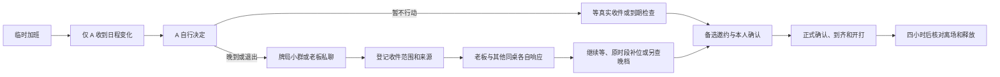

# 组局后的事件仿真与验收

## 实施前就绪评估

整体模型合理。营业变化是事件，顾客和店家的选择会产生新事件。世界变化、商量、同意和正式写入各有自己的证据。同一条链上可以有人不回复、拒绝等待或改变主意。只有实际送达的话和正式工具回执才能推动下一段业务。

| 能力 | 开测前判断 | 已有证据与验收缺口 |
| --- | --- | --- |
| 虚拟时钟、事件调度与聊天可见 | 基础就绪 | 角色账本能按来源去重、保存因果和未完成状态。既有群聊、老板私聊和搭子私聊能由实际收件唤醒。外部变化已有暴雨、堵车和按日工作安排。临时加班的动态事件及只通知本人，需新接入。 |
| 改期、退出和晚到 | 部分就绪 | 已有本人撤席、同局看板更新、晚到通知及收件后表态。晚到同意会核对真实收件和相关联系人。本轮仍需连起一次临场变化、本人消息、其余人意见和后续决策。 |
| 19:00 与 19:30 并行找人 | 业务事务已有对照 | 同根方案支持两个固定时点，互斥重叠报名由 Store 保证。现有测试覆盖一个方案满席后释放另一方案的共同席位。两档分别问谁、同桌选择如何同步、迟到者是否仍保留原局关系，尚未做事件链验收。 |
| 牌局临时小群 | 基础缺失 | 当前沙盒只在一个大群内投递和唤醒，群消息可见范围按该群名册处理。牌局群要有自己的会话、成员、邀请和实际收件记录。当前微信桥接只见现有群查找和发送入口，先做沙盒能力。 |
| 一人带一位未知同行 | 席位基础就绪，身份补全待做 | Party 能表示已登记的两席和已知报名联系人。未知同行没有私聊地址。正式到场仍需四位可辨认身份，需实现经队长邀请、本人入群后绑定对应匿名席。 |
| 沉默及第五人备选 | 部分就绪 | 现有等位需求可以在空位时通知并承接本人再报名。它按条件匹配，缺少「只等这一桌、这一版时间」的专属备选与确认期限。 |
| 避桌、烟况、性别与新手 | 部分就绪 | 有已披露的避桌关系和有烟、无烟匹配。性别已有软偏好及部分桌主硬条件，候选搜索还有评分路径。电子烟及新手没有独立可执行合同，不能用相近字段替代。 |
| 四小时、错峰离场与房态 | 四小时闭环已验证 | 已有四人开打、四小时后离场、释放及同房复订。迟到未开、有人晚走及后续离场需沿真实时间继续下发事件。业务状态显示结束时，仍核对实际开打和结束凭证。 |

先验证已有的退席、分支互斥、晚到回执、等位、避桌和房态。牌局小群、专桌备选及新匹配条件未就绪，整链验收要等对应底座可用。预设分支用于验证状态机和消息权限，自主回放再独立判断语言、决策与业务结果。 [测试素材](../eval/golden/venue_event_driven_scenarios.json)

评估后的第一阶段重跑了八组相关专项，120 项通过。覆盖 SQLite 和内存事务的备选互斥、真实晚到通知及同桌确认、退出及看板刷新、通用等位通知、避桌、房态与桌主条件确认。这批结果证实现有积木可复用，临时桌群和专桌第五人仍按后续阶段验收。

加班事件已接入滚动仿真，默认场景保持原有事件。这一阶段先走老板私聊。离线分支分别验证沉默保留原席、告知晚到可继续协商、明确退出只释放本人的席位。同日的其他事件与进程重开保留加班影响。中断恢复沿用已有决定和回执，不重复发送或写入。隔离 133 项相关回归通过，合并后重跑 11 项通过。小群承接和真实角色自然协商另行验收。

牌局小群已具备独立的沙盒送达账本。店家和已确认的具名角色进入同一局的小群。匿名同行必须由对应报名联络人邀请、本人接受后才入群，原业务席数仍为四。收件以实际投递时的名单为准，旁观者和后来加入的人拿不到未送达的历史，续跑也不会重复唤醒。隔离专项 73 项、合并后重点 13 项通过。这一阶段验证到角色唤醒证据，滚动调度、店家协调和匿名业务席位身份补全仍须接入。微信建群和拉人的实际接口仍待验证。 [桌群沙盒与回归](../tests/simulation/test_venue_table_group.py)

单桌第五人候补已加入受控沙盒。候补邀约、接受和等待保留旧四席。已有席位只在本人退出或本人明确授权的截止生效时释放。候补收到当前条件的空席通知再明确确认，才走原席位事务。离线覆盖续旧确认和过期竞态、变更时段、时长及烟况后的旧同意、两个写入方同时争一席，以及席位写入后注入故障时的事务回滚和重试。新增 11 个候补对照，隔离 80 项相关测试和最终合并 144 项专项均通过。当前候补决定来自受控输入，完整的真实模型桌群协商仍待接入。 [回归范围与阶段结果](venue_simulation_evidence/2026-11-27-event-coordination-controls.json)

## 事件与状态

人齐开桌在最后一席确认时已有四个席位，开场仍待协商。建桌群后，店家发布具体开场提议。四位本人必须收到该版提议并各自确认，才在同一个 Game 上落库开场。有人不能等、沉默、席位变化或只回答了旧提议时，保持待定。换一版提议后重新收集同意，四人实际到齐才开始计时。离线已验证从 19:00 被拒到四人确认 19:30、SQLite 重开、19:00 提前开打被拒、四小时后实际释放房间。18 项桌群、开场和房态相关测试通过。 [开场协商对照](../tests/simulation/test_venue_table_opening.py)

滚动仿真可用 `--rolling-table-groups` 启用四席自动建群。桌群通道只唤醒消息实际送达的同桌和店家。真实档挂接小群店家处理器，询问到店时间、根据本群发言提议开场，核对同一提议的回复后才通告结果。店家的提议和同桌闲聊使用各自的回合预算。默认四轮下已验证从店家先问时间、19:00 的首次提议、19:30 的改约发给四人，到四票写入及通知的完整调度。店家承接同一条收件时沿用其轮次，避免头两轮耗尽改约的唤醒机会。 [滚动桌群开场回归](../tests/simulation/test_venue_rolling_opening.py)

同一个运行用两轮验证普通私聊和大群时，已启用的桌群仍能完成上述协商。桌群和普通会话分别执行自己的轮次限制，受众及现场席位的判据一致。

如果一位先说 19:00 赶不上，另一位随后才建议 19:30，店家可以用本群后续实际发言提出新版。旧版仍有人明确拒绝才可触发改约，上一版的任何同意都不能代入新版。19 项桌群、协商、编组相关专项通过。 [分两条消息提出备选的回归](../tests/simulation/test_venue_table_opening.py)

50 角色离线容量验证从 12 张已满席的不同人齐开桌开始，48 位顾客分桌，2 位旁观。八路调度保存了 192 条桌群消息，12 桌各有询问、两版提议和四票确认后的正式通知。两位旁观者未收件，跨桌送达为零，续跑未重复发送。本轮覆盖的是建群、调度和落库容量。50 人真模型扩容仍走独立门槛。 [容量验证和档案校验值](venue_simulation_evidence/2026-11-27-table-group-capacity.json)

同样的 50 角色容量场可通过 `pytest tests/simulation/test_venue_rolling_opening.py -k fifty_actors` 重跑。回归重开业务库和调度账本，逐人核对所属桌群的 16 份真实收件、旁观者零收件和每桌仅有一次正式定时写入。

第五轮 OpenCode 中，一位顾客带两位同行登记三席，第四位顾客确认后从正式业务状态自然触发建群，老板和两位已具名顾客入群。实际跑次中两位未入群的同行保留匿名席。后续修订让店家在实际桌群提示报名联络人拉同行，同一阵容已送达的提醒不会重发。定向回归走原邀请、本人接收、接受和占原席的接口。固定桌保留原开场，人齐开桌在四位本人进入后才询问可到时间。本阶段的同行选择和邀请由受控测试发起，自主角色发出邀请仍待接入。 [自然建群与提醒回归](venue_simulation_evidence/2026-11-27-v5-table-companion-inquiry.json)

小群真模型受控对照 \`table-opening-dpd8mtoy\` 中，19:00 的提议收到三份同意和一份明确拒绝。实际回复提出 19:30 后，四位各自确认新时间才落同一局并通知。当前对照使用有时间范围的首轮提议和独立裁判，覆盖实际角色、群送达与 SQLite 落库。 [真模型四人来话及结果](venue_simulation_evidence/2026-11-27-table-opening-real.json)

常规滚动调度也接上了真实店家和真实角色。四位接受一块底方案且看到事前报名回执的对照中，店家从四位发言提出 19:30，收到同版四位本人确认后写入原局并发出小群回执。档位冲突对照未定时。两次各保留了因时间核验引用了其他顾客来话而未交付的草稿，兼容档的桌况通过，整次测试仍有一项未过。普通聊天两轮的设置下，调度保留了小群协商所需的轮次。 [两次滚动真模型和四张实际确认票](venue_simulation_evidence/2026-11-27-rolling-table-opening-real.json)

修正引用归属后第三次复跑，24 次桌群角色决定有效，程序判通过。查看票据发现，一位顾客两次表示最多打两三个小时，店家都当成同意已约四小时的桌，仍发了正式确认。语义复核判失败，原程序结果、两条顾客来话与店家处理一并保存。新验收同时核对时间和已知时长冲突。 [第三次回放的实际票据和复核](venue_simulation_evidence/2026-11-27-rolling-table-opening-real.json)

桌群询问开场时会说明已约定的时长。针对原来话的回归中，即使模型仍对「最多打两三个小时」判同意，店家也能从当前本人发言识别与四小时约定的冲突，保留三票、继续待定。该顾客明确表示能打四小时后，四人才可以定时。时长未知及普通确认仍经过原有判断。 [硬时长与正常确认对照](../tests/simulation/test_venue_table_opening.py)

更新后已通过带真实店家及四位真实角色的滚动桌群对照。四位角色都有事前接受一块底和四小时的来话及回执，到店时间各不相同。店家入群说明四小时，收实发来话后提议 19:30，四票同版且条件一致才写入原局并发确认。24 次桌群角色决定全部有效，旁观者未收件，原话与同版票据可回查。 [真模型正式通过的对照](venue_simulation_evidence/2026-11-27-rolling-table-opening-real.json)

无共同开场的对照中，一位 19:00 赶不上，另一位面对 19:30 明说只能打到 23:00，没同意四小时安排。最终实收三份同意，牌局未定时。复核保留原评测结论，分开记录「明确拒绝」和「有实质时间冲突的附条件回复」都不会进入确认票。另两次运行分别遇到末轮裁判结构错误和 OpenCode 中断，证据一并保存。 [无共同时间的原话与复核](venue_simulation_evidence/2026-11-27-table-opening-real.json)

沙盒同行身份已能补全。报名联系人发邀请，同行本人接受并产生实际入群记录后，通过 \`VenueTableParty.bind_companion\` 用同一个邀请绑定一个原有匿名席。席位总数始终是四，保留原报名联系人的审计来源。入群未绑定或发生撞局时不会产生业务席位。完成绑定后，新时间提议发给四位真实具名角色，同行仍要独立表态，流程能推进到四人正式到场。63 项隔离相关回归通过。 [匿名同行、定时和到场对照](../tests/simulation/test_venue_table_party.py)

同行成功绑定后，滚动调度从持久化业务事件唤醒原有桌群的店家，询问时间的实际回执送给四位。重开时沿用原群及已办结的唤醒。18 项合并专项通过。

已有一个原匿名席、报名联系人有唯一可联系且已启用的熟悉搭子时，滚动角色能从自己实际收到的店家提醒选择分享模拟群邀请。真正收件的同行独立选择接受、拒绝或等待。仅在接受且业务原席仍有效时补全该席，同一桌人数始终为四。其他人不见两位之间的邀请，新成员也不见加入前的群消息。离线专项用实际通道账本和开场协商验证了三处中断重开、撞局、拒绝及沉默。两位以上匿名同行或有多个可能人选仍需报名人补充。 [同行邀请、拒绝与四人定时](venue_simulation_evidence/2026-11-27-rolling-companion-invitation.json)

换座后先暂停旧名册的新投递。补位经正式业务确认并恢复四个具名席位时，模拟器在原桌群保存进退群回执，发起一轮新协商。原先三人的同意都留在旧提议里。新人只能收到入群后的消息，退出者只保留此前收到的内容。受控回归在名册事务落盘后中断并重开，复跑核对旧版待发未外送、新四人同意后才写同一局 19:30。 [换座与恢复回归](../tests/simulation/test_venue_rolling_opening.py)

新增可回放的人齐开协商条目，同时覆盖四人改约与双方时间冲突。桌群、角色、独立核验及开场边界合并检查 384 项通过。 [事件测试资产](../eval/golden/venue_event_driven_scenarios.json)

- 事件保留编号、发生及计划执行时间、源事件、牌局和方案版本、受众与去重依据。消息事件保留发送、实际送达和收件人；每个角色决定只投影当时确实可见的资料。
- 外部事件只改变本人的模拟日程。某人发消息后，相应收件才会使老板或同桌醒来。沉默由虚拟时钟和到期检查观察，保留原来仍有效的席位和表态。重复或过期事件拿原始回执去重，不改写较新的决定。
- 牌局聚合管理席位。候选、待确认、已确认、退出和物理到场分别记录。小群是沟通载体，群成员和席位可以相关联，入群本身不占位，退出群也不直接退席。
- 公共群和朋友圈用于公开招募。已有桌况变化优先通知该桌范围的参与者。夜间沿用凌晨早场案例的范围，来话人的业务回信仍可送达，主动邀约根据营业时间和通道权限检查。朋友圈作为独立的公开发布能力测试。

## 用例与分阶段验收

| 阶段 | 场景 | 通过标准 |
| --- | --- | --- |
| 1 | 业务与事件基线 | 从账本找齐实际来话、本人送达和时间版本。核验退席只作用于授权席位，两档的同一个人不会重复确认，晚到有真实通知和代表答复，四人正常离场后原房可订。 |
| 2 | 成局建小群 | 一次只建一个绑定该局的模拟小群。四个已知参与者与店家可加入，旁观者不可见。队长带一位时，邀请只能由其针对对应匿名席分享。由同行本人接受再绑定，已登记席位仍为四。重复、无关人员接受和退局后迟到邀请均有对照。 |
| 3 | 加班后协商或退出 | 让 A 只收到本人变化。分别覆盖晚半小时、晚一小时、不能来以及等待。只有 A 实发后，同桌才知道。B 可拒绝等，其他人可接受或沉默。退出后原局补位，晚到可以留下 19:00 和 19:30 两档候选。每个确认带实际时间版本，过时回执不占席。 |
| 4 | 沉默与第五位备选 | 变更后有队友一直没确认。到设定期限可并行问第五人并明确是备选。无空位时保留为候选。到期与迟来的原参与者回复竞态要复放，只有有效释放与备选本人接受同一版条件后才能换席。 |
| 5 | 邀约条件 | 用一个候选矩阵分别验证避桌、无烟、可电子烟、性别软偏好及明确限制、接受或不接受新手。每项区分符合、冲突、未知。可信本人资料才进入判断。硬条件不符合就不邀，未知可确认；对客公开内容不展开其他人的私下拒绝、身份或关系。 |
| 6 | 实际模型与营业闭环 | 用 4 位同桌加需要的备用顾客跑小样本，真实顾客按各自性格和消息决定。验收员分别核对来话可理解度、店家协调、渠道送达和实际营业结果。成局、合理未成局、晚走导致仍占房、真实离场后同房复订分别留痕。专项通过后再纳入滚动 12 人，随后按原验收扩容。 |

对失败保留触发事件、实际对话、相关回执、工具调用与 SQLite 变更。先找出断在事件、收件、角色表达、店家判断、供应商还是事务，再用原材料和至少一个正反例复跑。预期分支没有发生时记录覆盖缺口；顾客的自然拒绝、沉默、合理澄清或合理未成局仍可满足行为验收。
