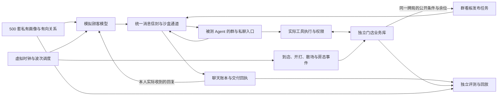

# 500 人麻将馆仿真实施路径与验收

以现有 Agent 的群入口、私聊入口、工具权限、业务存储和话术审查为被测对象。每次启动创建独立的沙盒运行目录和一座模拟门店。500 位顾客在同一个群里，也全都已经加了老板为好友。每位顾客与老板有一条独立、开局为空的私聊，老板初始只看到他们的昵称。固定种子复现人设、关系和初始事件。真实模型的发言有随机性，逐轮证据按实际结果保存。

[阶段进度、实验与排查记录](venue_simulation_progress.md)

## 阶段与发布

在 `codex/venue-simulation` 独立分支逐阶段提交和推送。每阶段运行影响范围内的专项测试，并保留相应的本地运行证据。

| 阶段 | 交付 | 验收 |
| --- | --- | --- |
| 1. 沙盒链路与本机模型 | 独立收发通道、三类数据隔离、虚拟门店及实际开局散场。沿用本机 OpenCode Go。 | 本机模型请求成功，离线完整牌局验证实际占房、四小时后释放和复订。真实模型运行结果单列。 |
| 2. 角色与并发 | 500 个可区分的性格与说话方式，按活跃度和关系互动。同群与独立私聊有受控并发。 | 同一条件下验证人物决策和话术差异，核对真实并行、同会话顺序、重复消息、群私聊隔离和末席竞争。 |
| 3. 开放式真实多轮 | 模拟用户从真实送达的回复继续说话，能补充、协商、等待或退出。Agent 走正式入口。 | 分别报告每人的实际轮次、因果续轮、成局、合理未成局和技术故障。抽样检查已知事实、重复追问、用户意向和真实工具证据。 |
| 4. 场景与稳定性 | 组合活跃波次、无匹配、临时改期、取消、关系冲突、迟到、房间不可用及同群多局。 | 固定种子可重放，报告各类场景覆盖和波动。离线压力能力、真实模型小批试验和扩大规模的真实验收分别记录。 |
| 5. 老板好友与群私聊往返 | 同一批 500 位顾客既是群友也是老板好友。昵称冷启动，好友可私聊开新局，也可看群看板后参与同一局。 | 核对 500 条独立私聊、实际回复的因果续轮、群看板和私聊回执关联到同一牌局，以及旁观者的可见范围。 |

最终用同一套插件完成群聊和独立私聊、模型角色、事件驱动的并发多轮、门店实际状态、可回放聊天与业务证据，以及分层评测。组局成功率作为观察结果。通过取决于是否理解客户、尊重约束、按实际状态处理并如实回复。合理不成局同样可以通过。

## 架构



虚拟时间由仿真事件推进。并行波次同一时间的不同顾客独立处理，下一波只领取各自已送达且可继续的会话。同一顾客一波至多一轮，底层 Runtime 仍执行自己的会话锁和发送版本检查。场景真值只供角色模型和评测读取。群消息里的公开信息、私聊收件范围和独立业务库分别形成可核对的记录。

老板的好友通讯录和群成员各自归档。当两位好友使用同一个昵称时，沙盒依据稳定的渠道账号把入站、回复和业务记录归到本人会话。稳定 ID 用于路由，昵称是老板初始能看到的顾客信息。好友身份提供直接私聊的入口，组局、报名、候补和预约仍依据顾客在会话中的具体授权执行。

## 实施路径

1. 在 `tests/simulation/venue_channel.py` 封装本地群聊与私聊收发。消息信封携带身份、目标、时间、正文和引用。进入现有群处理器或私聊 Runtime 前归档入站，实际回复按收件范围归档。成员私聊只对双方可见，评测会话可以读取完整事件记录。
2. 在 `tests/simulation/venue_actors.py` 生成稳定角色、可用时段和有方向的人际关系。角色模型只读自己的设定和能看到的对话，决定发言、等待、到店或离场。独立语义评测记录判断依据。Agent 初始化只收到公开身份和群成员关系。
3. 在 `tests/simulation/venue_scenario.py` 用事件队列推进虚拟时钟。场景安排活跃窗口、业务刺激和门店变化，角色按实际送达的消息继续互动。以到场的已确认成员、预订和受控门店事件办结实际开打与散场。测试可快进到下一事件。
4. 用 `scripts/run_venue_simulation.py` 启动并检查运行报告。离线模式验证接口和状态不变量，真实模式分别调用主 Agent、角色模型和语义评测。每轮保留原始证据，持续时间、消息数和模型流量独立受限。

## 存档

默认每轮位于 `runtime_data/venue_simulation/runs/<run_id>/`。目录包含 `personas.json`（仿真私有画像和关系）、`venue.json`（房型、容量、收费、设备、营业时间与初始检修）、`chat.sqlite3`（群与私聊原文、目标和交付）、`chat.jsonl`（便于回放的聊天导出）、`agent.sqlite3`（业务事实、会话与任务）、`events.jsonl`（调度、角色生成、业务检查和截止事件）、`agent_trace.log`（已执行的 Agent 步骤）和 `report.json`。用聊天事件的消息 ID 与 Agent trace 串联各文件。开局和结束以沙盒业务库的持久化结果为准。

`report.json.profile_evidence` 从 SQLite 分别统计正式画像字段的实际变动、任务记忆和长期候选。昵称初始记录和模拟顾客私有画像不计作 Agent 学到的画像。营业生命周期的 `memory_from_visible_message` 只验收到来话后产生了有证据的待审候选。验证长期使用还需确认正式画像落库，并在同一顾客的新任务中读取到该事实。

熟客专项 `.venv/bin/python scripts/replay_venue_returning_customer.py --case exact-existing-table` 用实际签到和散场记录建立个人常打组合，再用「帮我组个19:00的局呗」开启新任务。`open-code-customer` 由真实顾客模型决定首句，`exact-new-table` 验证无现成局时是否按本人一席建立 173 待组桌。报告保留查局实际参数、回复、客户模型来源和独立判定。

## 验收标准

| 范围 | 通过条件 |
| --- | --- |
| 人口与隔离 | 一个群内有 500 个唯一账号，老板的好友通讯录也覆盖这 500 人。每个账号可直达自己的私聊，开局仅建昵称且没有历史会话。重名也要独立收发。同种子复现私有画像和人际关系，顾客只能看到自己的私聊。顾客明确说出长期无烟偏好后，新的待审画像候选须链接该消息的原文与 trace。 |
| 互动闭环 | 用户主动找老板，真实 Agent 输入经过正式群或私聊入口。通过持久看板任务实际发布群看板，再由看见消息的角色行动。角色可以接受、协商、拒绝或等待。编排器以原始消息和真实确认判断进展。 |
| 用户发言质量 | 区分生成失败、合同不合格与 Agent 自身失败。保留角色动作、原文、可见依据和独立判断。人际关系影响角色决策，Agent 仅能从实际获知的信息推断。 |
| 完整聊天证据 | 群聊旁观消息、客户互聊、双向私聊和 Agent 群回复均可回放。重复投递保持一次交付。同一消息 ID 对应同一正文和收件范围。 |
| 门店物理状态 | 门店有单独的房间和营业配置。开打需有四名已确认到场者，房间满足容量、营业时段与可用性。占用中拒绝重叠预订。 |
| 四小时散场 | 以实际开打时刻为起点。结束前房间仍被占用，到期通过可信业务流程记实际散场与预约释放。以重开 SQLite 后读到的时间、终态、释放记录和下一局可订为证据。 |
| 模型与回放 | 离线合约通过与真实模型通过分别记录。生成、回复、交付和判定都有可追踪记录。受控场景未办成时报告失败和原因，固定种子保证初始条件，保存的事件还原已发生对话。 |

开放式评测增加三层证据。第一层确认消息真正送达对应客户，续轮存在可见的因果来源，统计每人往返轮数、因果链最长长度及不同私聊的在途峰值。第二层核对实际工具与落库，分别报告查到选项、成局、办结、等待、无匹配、拒绝、取消、到期未成和技术故障。第三层抽样语义判定，分别核对顾客的询问范围、真实续轮理由与收尾，以及店家的回复、查询事实和授权。顾客项通过必须引用全部实际动作，已知连续时段被无理由拆成多个钟点询问时判失败。报告保留每类结果与证据，覆盖量与成功率分别查看。

开放场景验收要求每个目标客户都有动作证据，使用多名工作线程时至少有两个交付实际重叠，并逐人核对业务结果。真实模型可以在首轮已获得答案时退出，有已答复的续轮则必须关联本人此前收到的回复；轮数保留为统计。离线合约专项仍验证多轮因果，500 人离线压力专项要求全部完成两轮并完整落盘。真实模型阶段还需通过独立语义抽样。

首次运行以一个主动组局、搭子参加、回避关系拒绝和四小时办结的场景为重点。背景用户按不同活跃度参与；500 指同一群的成员总数，活跃规模由运行参数控制。

## 真人试用前演练

选用不同日期与种子，用 OpenCode Go 给顾客做逐人决策。演练分配杭麻、川麻、红中玩家，并根据日期、班次、请假与出行生成各自的空闲和位置。天气、堵车和异地只进该顾客的上下文。老板只能通过实际送达的消息得知这些变化。

突发案例的落库验收包括暴雨退出后只释放本人席位，迟到或远距离协商不擅自改整桌，异地拒邀不增加席位，以及上午打完后下午查新的库存。角色发言和老板回复由不同客户端调用，分别判语义。每次保留实际交付、权限、工具和重开 SQLite 的证据。初步受控真人试用还需要看板和私聊跨会话隔离，以及确认实际通道的开启范围和人工接管条件。

用两个营业日分别跑五类扰动，周末日期只改变演练时钟。

```bash
.venv/bin/python scripts/run_venue_simulation.py --mode real --model-source opencode-go --scenario disturbances --seed 42 --date 2026-11-25 --guard-writes
.venv/bin/python scripts/run_venue_simulation.py --mode real --model-source opencode-go --scenario disturbances --seed 73 --date 2026-11-22 --guard-writes
```

定位失败时可用 `--disturbance-case` 选 `rain`、`traffic`、`long_commute`、`out_of_town` 或 `repeat_visit`。真实角色可以选择不回复，报告保留该动作及独立判定。需要顾客来话才能验证的取消、拒绝等闭环仍须有实际来话和写入证据。模拟店员送达的邀约只验证顾客收到邀约后的链路。

外地拒邀专项可重放工作日原话，或用只拒绝当晚邀约的相邻用例。两例先实际送达邀约，再经正式私聊执行。报告核对同一轮工具记录、重开 SQLite 后的拒绝状态、原席位和另一位顾客的已发邀约。另约通知单独核对真实安排和实际回复。

```bash
.venv/bin/python scripts/replay_venue_invite_decline.py --case archived --guard-writes
.venv/bin/python scripts/replay_venue_invite_decline.py --case decline-only --guard-writes
```

专项重放使用冻结顾客原话验证真模型店家，整轮演练另查 OpenCode 顾客当轮的自主决策与来源证据。

现成局按实际约定开场筛选完整时段。开局区间外十分钟内可以另查最近的相容桌作为备选，每边最多一桌。顾客明确表达最早到店或最迟可开的界限时，推荐尊重该侧界限。区间内查无具体开场不能推断未定开场的局也无法协商。

## 启动

在新机器上可用 Python 3.11 或更高版本创建虚拟环境，然后执行 `.venv/bin/python -m pip install -e '.[dev]'` 安装专项依赖。

```bash
.venv/bin/python scripts/run_venue_simulation.py --mode mock --background-events 36
.venv/bin/python -m pytest -q tests/simulation/test_venue_scenario.py tests/test_actual_game_play.py
```

开放式会话走同一沙盒 Agent。一个波次同时唤醒多位顾客，每位顾客收到自己的已交付回复才有下一轮。分开统计真正有因果关系的多轮、实际同时在途的交付及各类业务结果。

```bash
.venv/bin/python scripts/run_venue_simulation.py --mode mock --scenario dialogues --active-users 32 --workers 8 --dialogue-turns 4
.venv/bin/python scripts/run_venue_simulation.py --mode real --model-source opencode-go --scenario dialogues --active-users 4 --workers 2 --judge-users 3
```

扩大真实规模前分别验收两个独立门店用例。成局用例的初态有三位已报名者及一张兼容的空席，待测顾客只拿到本人的画像和意向。通过要求两轮实际私聊、收到选项后的真实顾客续轮、正式工具确认第四席，以及牌局最终满座。合理未成局用例从空局池开始，顾客知道完整可开局时段，验收实际查询无匹配、顾客可自然结束和语义通过，并核对没有新建牌局。

```bash
.venv/bin/python scripts/run_venue_simulation.py --mode real --model-source opencode-go --scenario formation --active-users 1 --workers 1 --dialogue-turns 3 --judge-users 1
.venv/bin/python scripts/run_venue_simulation.py --mode real --model-source opencode-go --scenario no-match --active-users 1 --workers 1 --dialogue-turns 2 --judge-users 1
```

混合场景在同一门店库存中验证成局和合理未成局。一位顾客可自行决定加入兼容的牌桌，其他顾客按各自偏好查找不同玩法。验收核对逐人的因果续轮和确认，同时检查不匹配来自真实条件限制，查询当时确实还有其他玩法的空席。如果顾客看到查询结果后又明确委托候补，混合场景可按已登记的等待状态通过。该转变必须有独立写入授权、同一顾客的正式工具回执和持久化证据。专门的只读场景继续只验收无匹配。

```bash
.venv/bin/python scripts/run_venue_simulation.py --mode real --model-source opencode-go --scenario mixed --active-users 3 --workers 2 --dialogue-turns 3 --judge-users 3 --clarify-consent
```

可在独立副本追加 `--guard-writes` 验证私聊写入边界。许可模型在正式 Runtime 处理前读取顾客当前原话和实际交付的本人会话，给出可引用的授权范围。查询保持可用。建局、报名、候补与包间的对应工具还需通过正式网关。授权决策及拦截留在本地运行目录，结构化报告只导出汇总。角色画像与测试期望继续由角色模型和独立评测分别读取。

好友主动组局场景 `private-initiation` 从空牌局库存开始。顾客可直接发给老板，从自己的会话提出新组需求并根据收到的回复补条件。只在正式工具实际建局、回复送达本人、SQLite 持久化同一个组织者和私聊来源后计为发起成功。多人运行时逐一归属各自的新局。到达待组或招募状态即可验收发起链路，四人满座和实体开打仍分别统计。

```bash
.venv/bin/python scripts/run_venue_simulation.py --mode real --model-source opencode-go --scenario private-initiation --active-users 1 --workers 1 --dialogue-turns 4 --judge-users 1 --clarify-consent --guard-writes
```

群聊与私聊联动场景 `friend-group-link` 沿用同一个私聊建局流程。正式发布任务把这局的公开条件和余位放到群看板。另一位好友从已送达的看板发现这桌，按看板报名或私聊老板。报名成功后核对本人私聊回执和 SQLite 席位，群看板从同一个牌局生成新版。旁观者只看到公开收发，原私聊和报名者的回执保存在本人会话里。

```bash
.venv/bin/python scripts/run_venue_simulation.py --mode real --model-source opencode-go --scenario friend-group-link --active-users 1 --workers 1 --dialogue-turns 4 --judge-users 1 --clarify-consent --guard-writes
```

纯私聊两轮压测可给摘要命令加 `--audit-owner-friend-routes`。它重新打开聊天 SQLite，并与角色事件核对每位活跃好友的独立路由、两条实际回执及第二轮的来由。

```bash
.venv/bin/python scripts/run_venue_simulation.py --mode real --model-source opencode-go --scenario mixed --active-users 8 --workers 4 --dialogue-turns 3 --judge-users 8 --clarify-consent --guard-writes
```

真实模式可用 `--mode real --model-source opencode-go`。它读取本机 OpenCode Go 模型配置，并使用既有环境变量或本机配置绑定的密钥文件。角色和独立判定各用一个客户端。显式选用项目配置时，用 `--mode real --model-source project --env-file <模型配置文件>`。主 Agent 沿用 `MAHJONG_LLM_*`。角色与判定分别可用 `MAHJONG_VENUE_ROLE_*` 和 `MAHJONG_VENUE_JUDGE_*` 指定 `API_KEY`、`MODEL`、`BASE_URL` 后缀。角色组也支持现有的 `MAHJONG_SIM_GENERATOR_*`。真实生命周期场景默认三个背景唤醒，真实并发场景默认不加背景唤醒，可通过 `--background-events` 设置最多 500 个。

### 模拟顾客怎样作决定

真实模式由独立的角色模型客户端逐次驱动顾客。多个顾客可以共用 OpenCode 上同一种模型，每次请求只装入该顾客自己的表达习惯、做事倾向、可用时间、关系、当下意向和这次实际能看到的群聊与本人私聊。调度器安排何时醒来、看到哪条消息、今天有什么机会，顾客模型自己选发言、措辞、收件人、等待或离场。原始模型输出和实际投递分别归档，可查到后续动作接住了哪一条回复。

角色请求没有门店工具权限。它说出的话经沙盒通道当普通顾客消息交给被测 Agent。Agent 只能通过自己收到的消息和工具结果了解此人，业务承诺还要经过正式权限和持久层。固定种子复现画像和场景初态。离线合同桩用于接口和压测，真实验收观察模型自由生成的行为。

真实角色有一次受同一总期限约束的格式修正机会。只有能从首个输出中明确识别原有动作和允许的收件人时才请求修正，动作、正文和渠道保持相同。归档保留首份原文和最终模型响应。业务判断、等待和拒绝直接来自角色模型。

角色模型和被测 Agent 只走本地归档通道。模型供应商故障时报告保留已发生的角色决策和 HTTP 证据，语义验收记为未得出结论。检查值 `null` 表示未执行。真实模式用独立判定结果和所有硬断言共同判断通过。

时间相关的拒绝优先通过 `--date YYYY-MM-DD` 或受控场景修正。每次运行都有独立 Runtime 和 SQLite；并发任务使用各自固定的虚拟时间。当地真实服务和真实渠道使用其当前配置。只在副本复现出同一领域缺陷时才评估是否需要修改共享 Runtime。
